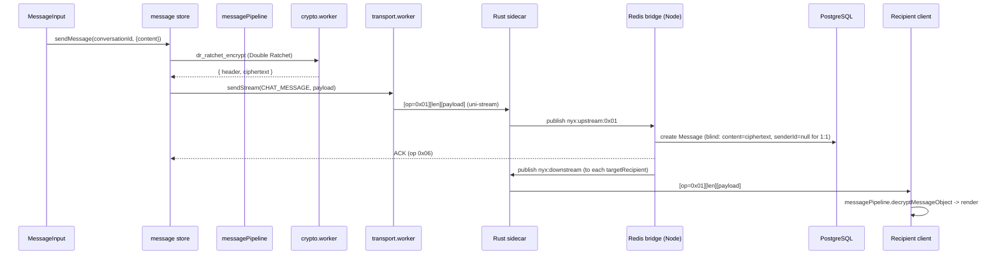

# 15 — Messaging (End-to-End Send/Receive)

How a single message travels from the sender's keystroke to the recipient's screen — and back as a read receipt. Covers the full E2EE pipeline, message statuses, and every message-level feature (reactions, edits, unsend, view-once, silent, expiry, voice).

## 15.1 The core pipeline

- **Encryption** happens in `web/src/workers/crypto.worker.ts` (`dr_ratchet_encrypt` / `group_ratchet_encrypt`); the main thread reaches it via `crypto-worker-proxy.ts`.
- **Decryption** is centralized in `web/src/lib/messagePipeline.ts` (`decryptMessageObject`) — the single source of truth for text + file keys, ratchet handling, and `waiting_for_key` states. Never duplicate this logic in a component.
- **Optimistic UI:** `addOptimisticMessage` writes a temp message (`temp_<ts>`), then `replaceOptimisticMessage` swaps it for the server-confirmed one on ACK.

## 15.2 Sending vs receiving (1:1 and group)

| Path | Encryption | Key source |
|---|---|---|
| 1:1 | Double Ratchet (PQX3DH-seeded) | `SPQR`/`PQ_DR` session state (`ratchetSessions` in IDB, encrypted at rest) |
| Group | Sender-Key ratchet | per-(conversation, sender) sender/receiver state in `keychainDb` (`ENC1:` at rest) |

- The fan-out for groups is **client-side**: the sender distributes its sender key to every member via `messages:distribute_keys` (persisted as a SYSTEM control message for offline delivery).
- Own messages are decrypted back using the stored message key (`mk`), falling back to the DR path; on final failure the message is marked `waiting_for_key` — never an error bubble.

## 15.3 Message statuses & read receipts

- Statuses: `SENT` → `DELIVERED` → `READ`. The server stores `MessageStatus` rows and relays `message:status_updated`.
- **Arrived ≠ read.** Messages that merely arrive live (`doAddIncomingMessage`) or are backfilled on connect (`loadMessagesForConversation`) are receipted `DELIVERED` via `sendDeliveryReceipts` (`web/src/lib/deliveryReceipts.ts` → `messages:mark_delivered`, chunked at the server's batch limit, with an explicit messageId → senderId `targets` map because 1:1 sealed-sender rows store a `NULL` sender on the wire). `READ` comes only from `ChatWindow`/`MessageItem` when the bubble is actually visible.
- **Statuses persist at rest.** `Message.statuses` is stored in the Shadow Vault as a sealed (`ENC1:`) structural column. A write that does not carry `statuses` (server copy, partial tombstone) keeps the stored value; `statuses: []` means “no receipts”; malformed entries are dropped without failing the row.
- **1:1 read = TTL grace, not immediate delete:** a READ receipt arms a 24-hour grace window (`READ_DELETE_GRACE_MS`) on the server row; the `messageSweeper` deletes after expiry. Receipts are one-shot — repeat READs never extend retention. The grace doubles as the **heal window** (§15.7.1): ciphertext that failed to decrypt client-side can be re-fetched for re-decryption once keys are repaired. Client-side, READ receipts are only sent for messages that **successfully decrypted** (`isLiveReadSafe` / `isUndecryptable` guards) — a premature receipt used to destroy the only server copy.
- `ChatWindow` batches mark-as-read events and only fires them when the Virtuoso row is actually visible (IntersectionObserver).

## 15.4 Reactions, edits, unsend

All three are **E2EE tombstone control messages** carried through the normal message envelope and evaluated by `evaluateControlMessage` in `messagePipeline.ts`:

| Feature | Payload type | Notes |
|---|---|---|
| Reaction | `reaction` / `reaction_remove` | `sendReaction`; rendered by `ReactionsDisplay` |
| Edit | `edit` | limited to 5-minute window, own messages, non-file, non-system |
| Unsend | `UNSEND` | `message:unsend` → server verifies sender or `deleteSecret` → `message:deleted_remotely` to recipients (handled in `socketListeners.ts`, which marks the row `isDeletedLocal` like a local delete) |

## 15.5 View-once, silent, expiry

- **View-once:** `isViewOnce` flag; when viewed, the server deletes the message (`message:view_once_opened` → `message:viewed` → `prisma.message.delete`). The sender's client handles `message:viewed` and hides its own copy (the row no longer exists server-side).
- **Silent:** content wrapped as `{ type:'silent', text }` — no notification on the recipient side.
- **Expiry/auto-delete:** `expiresAt` on the message; `messageSweeper` (cron, every minute) deletes expired messages and notifies recipients via `message:deleted_batch` (each id marked `isDeletedLocal` client-side on arrival).
- **`expiresAt` is not the auto-delete flag.** In 1:1 it is *always* set (14-day store-and-forward TTL, shortened to 24 h after READ), so the sender's actual choice travels inside the ciphertext as `autoDelete: true` (alongside the precise `sentAt`). `captureAutoDelete()` removes it on decrypt (a leftover field breaks the plaintext-collapse and renders raw JSON), and the flag is persisted sealed in the Shadow Vault. `MessageBubble` renders the countdown only when `autoDelete` is set.

## 15.6 Voice messages

- Recorded in `MessageInput` with `MediaRecorder` (Opus in WebM).
- **Anonymization (DSP):** optional lowpass filter + 40 Hz sine ring modulation applied in an `AudioContext` before the stream is captured (`handleStartRecording`).
- Encrypted like any file (secretstream) and delivered with a `duration` field; rendered by `VoiceMessagePlayer`.

## 15.7 Offline & reconnect

- **Offline queue** (`offlineQueueDb.ts`): messages composed while disconnected are persisted and re-sent on reconnect (`processOfflineQueue`).
- **Pending mail:** the server keeps messages for 14 days (`GET /api/messages/:conversationId?limit=250`). On (re)connect, `socketListeners.doSyncMessages` fetches each conversation's pending messages; `loadMessagesForConversation` sorts chronologically and processes control messages (group keys, metadata) first so keys arrive before encrypted content.
- Messages are deduplicated by id against the Shadow Vault.

### 15.7.1 DR session resilience — the 1:1 era invariants (2026-10, libsignal-derived)

The 1:1 Double Ratchet state follows the same discipline as the group pipeline
(§16.7.1), modelled on libsignal's `SessionRecord` /
`session_cipher_legacy.rs`. Previously `ratchetSessions` held a **single mutable
row** — a new X3DH/DH step destroyed the old state, and skipped keys were
one-shot, so out-of-order or late-arriving messages failed permanently with
`Ratchet Advanced!`:

1. **Archived session (fallback era lookup).** Before a state is overwritten,
   `storeRatchetSession` archives the old one under `` `${conversationId}#archived` ``
   (one slot — mirrors `ARCHIVED_STATES_MAX_LENGTH`, simplified). When the current
   state misses (`Ratchet Advanced` / `older than current state` / MAC failure),
   `doDecryptMessage` retries with the archive **before** declaring failure — the
   `promote_old_session` pattern. Archive misses never advance the current state.
2. **Skipped keys persist (MK-persist).** `deleteSkippedKey` is now a no-op; keys
   accumulate in `skippedKeys` with an LRU cap of 200/conversation in
   `storeSkippedKey` (mirrors `state.set_message_keys`). Repeated reloads can
   still decrypt messages whose message keys the ratchet already passed.
3. **Duplicate = success.** The per-`messageId` MK cache is checked at the top of
   the DR path; an already-decrypted message decrypts from cache instead of
   colliding with the advanced ratchet (controlled `DuplicatedMessage` semantics).
4. **Erase-path audit.** Soft logout only clears the auto-unlock slot — the
   at-rest keychain (ratchet sessions, skipped keys, MK cache) survives relogin;
   `clearAllKeys()` runs only in the nuke path. `deleteConversationKeychain`
   also removes the archive.

Not adopted deliberately: Signal's `MAX_FORWARD_JUMPS=25_000` (too loose for NYX's
threat model — `MAX_SKIP=1000` stands) and the manual identity-key approval
prompt (NYX warns automatically, consistent with its opaque/blind-index posture).

## 15.8 Ghost sync & link preview

- **Ghost sync** (`fireGhostSync`): sends a `GHOST_SYNC` system message to a group to reconcile membership/key state after a metadata change.
- **Link preview:** `fetchTypingLinkPreview` in `messageInput.ts` hits `POST /api/previews` (SSRF-safe `secureLinkPreview.ts`); rendered by `LinkPreviewCard`.

## 15.9 Files to know

| File | Role |
|---|---|
| `web/src/store/message.ts` | send/receive, optimistic updates, statuses, offline queue, reactions |
| `web/src/store/messageInput.ts` | composer state, staged files, reply/edit/expiry/view-once/HD/anon |
| `web/src/lib/messagePipeline.ts` | central decrypt + control-message evaluation |
| `web/src/lib/offlineQueueDb.ts` | offline send queue |
| `web/src/workers/crypto.worker.ts` | ratchet encrypt/decrypt, secretbox |
| `server/src/network/redisBridge.ts` | `handleChatMessage`, status updates, unsend, view-once |
| `server/src/routes/messages.ts` | pending fetch, blind send, blind delete |
| `server/src/jobs/messageSweeper.ts` | expiry sweep |
