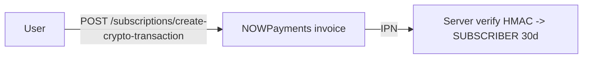

# 20 — Trust Tiers & Subscriptions

Anti-spam trust tiers and the crypto-only subscription flow — plus the auxiliary AI/reporting/admin surfaces.

## 20.1 Trust tiers (anti-spam without PII)

| Tier | How you get it | Rate limits (`constants.ts` LIMITS) |
|---|---|---|
| **Sandbox (UNVERIFIED)** | default on registration | 5 msg/min, 0 groups, no uploads |
| **FREE (verified)** | `isVerified` via WebAuthn **or** PoW | 15 msg/min, 100 group members, 100 MB uploads |
| **SUBSCRIBER** | paid (see §20.2) | 50 msg/min, 500 members, 500 MB uploads |

- **Proof-of-Work:** `GET /api/auth/pow/challenge` (Argon2, difficulty escalates via Redis INCR), `POST /api/auth/pow/verify` sets `isVerified`.
- **WebAuthn verification** also registers a passkey (see `14-auth-identity.md`).
- The server enforces `sandbox:newchat:<user>:<date>` (max 3 new chats/day for unverified) via the atomic Lua counter.
- The client surfaces upgrade prompts in `SubscriptionModal`.

## 20.2 Subscriptions

- **Crypto — NOWPayments (the only payment rail)**: creates an invoice (`price_currency: idr`, `is_fee_paid_by_user`). `POST /nowpayments-webhook` verifies `X-NowPayments-Sig` (HMAC-SHA512 over key-sorted JSON); on `finished` the user is upgraded and `subscription_updated` is emitted.
- [PAYMENTS CRYPTO-ONLY] The fiat rail (Tripay: `POST /create` + `POST /webhook`) was removed entirely — even with an anonymous alias, fiat rails create a financial paper trail that contradicts the zero-knowledge promise.
- The webhook route is exempt from CSRF and uses **constant-time** signature comparison.
- **Expiry:** `GET /api/users/me` lazily downgrades expired subscribers; `systemSweeper` (daily) also downgrades.

## 20.3 Reports & admin

- `POST /api/reports/user` and `POST /api/reports` forward to Discord webhooks ("NYX Watchdog" / "NYX Reporter").
- **Admin console** (`/admin-console`, `AdminDashboard`): `GET /api/admin/system-status` (VPS/DB/R2 metrics), `banned-users`, `ban`/`unban`.

## 20.4 Files to know

| File | Role |
|---|---|
| `web/src/store/verification.ts` | verified status |
| `web/src/components/SubscriptionModal.tsx` | upgrade UI |
| `web/src/pages/AdminDashboard.tsx` | admin console |
| `server/src/routes/subscriptions.ts` | NOWPayments (crypto-only) |
| `server/src/routes/auth.ts` | PoW challenge/verify |
| `server/src/routes/admin.ts` | admin endpoints |
| `server/src/routes/reports.ts` | Discord reports |
| `packages/shared/src/constants.ts` | LIMITS |
