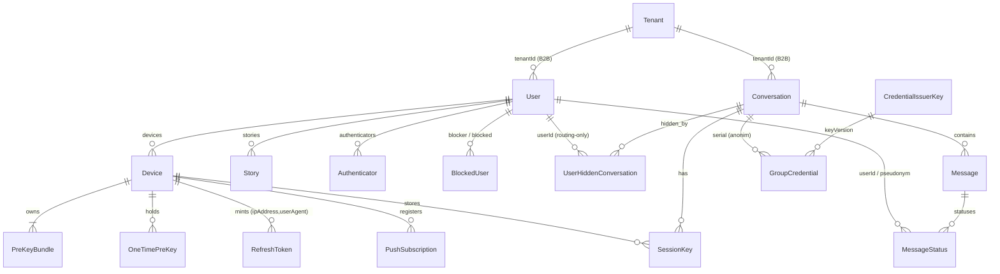

# 28 — Threat Model: DB Dump (menuju ZK sesungguhnya)

> **Status:** AUDIT **SELESAI** — seluruh rencana (Tier 0–3 + residual) sudah
> mendarat di kode. Dokumen ini kini berfungsi sebagai catatan ancaman +
> guardrail, bukan rencana tertunda. Lihat §28.5 (status per item), §28.6
> (residual yang sengaja dibiarkan), §28.7 (artefak & verifikasi) serta
> §28.8–§28.9 (detail implementasi).
> Baseline audit: `main` @ `2464f23f` (2026-10-08). Kolom/angka di §28.1–§28.3
> menggambarkan keadaan **sebelum** perbaikan. Fokus permintaan: **privasi ekstrem —
> apa bahaya terburuk bila database di-dump**, lalu apa yang masih harus diubah.
>
> Aturan yang TIDAK boleh dilanggar oleh rencana ini: format kripto beku
> (`ENC1:`, amplop XChaCha `base64url(nonce(24)||ct)`, `ENCRYPT_DATA` array
> angka, padding 8KB, opcode transport, skema tempId). Lihat docs 03/04/05.

## 28.0 Skenario musuh (yang harus tahan)

| Kode | Kemampuan musuh | Contoh nyata |
|---|---|---|
| **A1** | Baca `pg_dump` / snapshot disk / backup yang bocor. **Read-only**, tidak bisa menulis DB, tidak bisa memanggil API. | Backup harian `/root/backups/` bocor, snapshot VPS dicuri, dump diberi ke vendor/penegak hukum |
| **A2** | A1 **+ akses jaringan/API** (bisa memakai rahasia yang ditemukan untuk memanggil endpoint) | Dump bocor + penyerang punya akun sendiri |
| **A3** | Dump **+ tulis DB** (mis. kompromi kredensial root DB) | SQL injection massal, VPS takeover |
| **A4** | Dump **+ kunci privat issuer/konten** | Kombinasi dengan kebocoran env |

Kripto NYX sudah dirancang untuk tahan **A1** terhadap *isi pesan* (server hanya
memegang ciphertext E2EE; masterSeed tidak pernah ke server). Dokumen ini mengukur
apa yang **masih** bocor padahal isi pesan aman: **graph sosial, rahasia otoritas,
dan metadata temporal.**

## 28.1 Inventaris — 17 tabel & perannya

> **Baseline pra-perbaikan.** Kolom yang disebut di sini (mis. `Device.name`,
> `Device.installationId`, `User.externalId`, `PushSubscription.endpoint`,
> `Conversation.metadata`, `CredentialIssuerKey.privateKeyPkcs8`,
> `RefreshToken.ipAddress`/`userAgent`) sudah **diubah atau dihapus** di Tier 0–2
> — lihat STATUS per temuan di §28.3 dan status per item di §28.5.



Catatan: `Message.senderId` **bukan** FK (pseudonym untuk grup v2, `NULL` untuk
1:1). `MessageStatus.userId` dan `UserHiddenConversation.userId` juga bukan FK ke
`User` di skema Prisma, tetapi keduanya diisi **userId asli** pada jalur 1:1
(lihat D2).

| Tabel | Isi | Bisakah server membacanya? |
|---|---|---|
| `User` | `usernameHash` (blind index), `passwordHash`, `encryptedProfile`, `encryptedContactBundle`, role/ban/subscription, `lastActiveAt`, `autoDestructDays`, `externalId` | Sebagian: blob opaque aman; blind index + metadata tidak |
| `Tenant` | `name`, `apiKey` (plaintext), `allowedDomains` | Ya (plaintext) |
| `Device` | public keys (X25519/ML-KEM/Ed25519), `fingerprint`, `installationId`, `name` | Ya — identifier perangkat |
| `PreKeyBundle`, `OneTimePreKey` | material publik PQX3DH | Ya (memang publik) |
| `RefreshToken` | `jti`, `familyId`, `ipAddress`, `userAgent`, `deviceId`, rantai rotasi | Ya — metadata sesi |
| `SessionKey` | `encryptedKey`, `initiatorCiphertexts` (terenkripsi masterSeed) | Tidak (opaque) — tapi graph sesi terlihat |
| `PushSubscription` | `endpoint`, `p256dh`, `auth`, `deviceId` | Ya — identifier perangkat push |
| `Conversation` | `isGroup`, `encryptedMetadata`, `authSecret` (plaintext), `adminSecretHash`, `lastMessageAt`, `metadata` (JSON tenant) | Ya untuk `authSecret` & timestamp |
| `Message` | `content` (ciphertext E2EE), `deleteSecret` (plaintext), `senderId` (pseudonym/NULL), `sessionId`, `repliedToId`, `isViewOnce/isViewed`, `createdAt`, `expiresAt` | Ciphertext tidak; secret & metadata ya |
| `MessageStatus` | `userId` (asli untuk 1:1), `status`, `updatedAt` | Ya — pembaca + waktu baca |
| `UserHiddenConversation` | `userId` (asli, routing-only), `deliveryToken` | Ya — keanggotaan grup |
| `GroupCredential` | `serial` (64-hex), `conversationId`, `keyVersion` | Ya — tanpa identitas (desainnya sudah benar) |
| `CredentialIssuerKey` | `publicKeyJwk`, **`privateKeyPkcs8` (PLAINTEXT)** | Ya — **akar kepercayaan** |
| `Authenticator` | `credentialID`, `credentialPublicKey`, `counter`, `transports`, `credentialDeviceType` | Ya — perangkat/biometrik |
| `BlockedUser` | `blockerId`, `blockedId` | Ya — edge sosial eksplisit |
| `Story` | `senderId` (FK!), `encryptedPayload`, `expiresAt` | Author↔story terlihat |

## 28.2 Apa yang bisa direkonstruksi dari dump (A1)

Yang **tidak** bisa: isi pesan/story/profil, kunci privat, session key (terenkripsi
masterSeed), kontak (opaque bundle).

Yang **bisa** — inilah bahayanya, diurutkan dari terburuk:

1. **Graph sosial penuh 1:1 dan grup.** Bukan dari `senderId` (sudah `NULL`/pseudonym),
   tetapi dari pasangan `MessageStatus.userId` + `UserHiddenConversation.userId` +
   `Message.conversationId`. Hasilnya: "A dan B punya percakapan", "C ada di grup G",
   plus **siapa membaca pesan apa, kapan**.
2. **Peta perangkat & sesi.** `Device` (nama perangkat, fingerprint, installationId),
   `RefreshToken` (IP-hash, userAgent, rantai rotasi), `PushSubscription`
   (`endpoint` FCM/APNs), `Authenticator`. → satu manusia = N perangkat, dengan
   identifier yang tahan clear-cookie.
3. **Pola waktu/traffic analysis.** `Message.createdAt` (+ `expiresAt`,
   `isViewOnce`, `isViewed`, `repliedToId`, `sessionId`), `Conversation.lastMessageAt`,
   `Device/User.lastActiveAt`, `Authenticator.counter`, `OneTimePreKey.createdAt`.
   → siapa aktif kapan, siapa membalas siapa, kecepatan balasan, kapan grup ramai.
4. **Rahasia otoritas (langsung bisa dipakai bila A2):** `CredentialIssuerKey.privateKeyPkcs8`,
   `Conversation.authSecret`, `Message.deleteSecret`, `Tenant.apiKey`.
5. **Deanonymisasi identifier:** `usernameHash`, IP-hash, `Device.fingerprint`
   (semuanya hash **tanpa kunci** atas input berentropi rendah → reversibel).

> **Setelah Tier 0–3:** kelima poin di atas sudah tertutup atau dipersempit —
> rincian per temuan di §28.3. Yang **sengaja** dibiarkan (mis. graph percakapan,
> `Conversation.isGroup`, `Authenticator.counter`, `PushSubscription.p256dh`/`auth`)
> didaftar eksplisit di §28.6.

## 28.3 Temuan

Severity: **KRITIS** (langsung membuka akses / memalsukan identitas), **TINGGI**
(deanonimisasi terarah / graph), **SEDANG** (metadata & korrelasi), **RENDAH**
(graph tanpa identitas / material publik).

### D1 — KRITIS: kunci privat issuer grup ada di dalam DB
`CredentialIssuerKey.privateKeyPkcs8` disimpan plaintext di kolom DB
(`server/prisma/schema.prisma`, model `CredentialIssuerKey`; komentar: "prod:
backup terenkripsi"). Presentasi credential = verifikasi tanda tangan issuer +
serial terdaftar untuk conversation (`server/src/lib/groupCredentials.ts:132-160`),
dan serial di-commit oleh klien (`server/src/routes/conversations.ts:110-128`).

**Bahaya terburuk:** pemegang dump bisa memalsukan credential untuk grup mana pun;
dengan A3 (tulis DB) atau A2 (akun sendiri + commit serial) → **masuk grup tanpa
diundang / mengaku anggota**. Ini satu-satunya item yang *secara langsung*
mematahkan jaminan privasi grup — bukan cuma kebocoran informasi.
**Target:** kunci privat keluar dari DB (env/KMS/file 0600), kolom dihapus setelah migrasi.
**STATUS: SELESAI (Tier 0.1).** `privateKeyPkcs8` **dihapus** dari schema; kunci
privat dibaca dari env `GROUP_ISSUER_KEY_PKCS8` (dev: file `.nyx-issuer-key` 0600,
gitignored), mismatch env↔DB = fail fast, production tanpa env = fail-closed.
Guard: `tests/schemaPrivacy.test.ts` (D1).

### D2 — KRITIS: penghapusan `senderId` belum menghapus edge 1:1
`Message.senderId` sudah `NULL` untuk 1:1 dan pseudonym untuk grup v2 — benar.
Tapi:
- `MessageStatus.userId` menyimpan **userId asli** untuk 1:1: `persistedReaderId =
  msg.conversation.isGroup && readerPseudonym ? readerPseudonym : userId`
  (`server/src/network/realtimeHandlers.ts:816`, upsert di `:824`).
- `UserHiddenConversation.userId` menyimpan **userId asli** setiap anggota yang
  mengirim token: `server/src/routes/messages.ts:237-241`,
  `server/src/routes/conversations.ts:365-369`, `server/src/network/realtimeHandlers.ts:300-304`.

**Bahaya terburuk:** dump memberi graph "A↔B" yang lengkap (siapa lawan bicara
siapa, kapan pesan dibaca) — sehingga efek privasi = setara sebelum penonimaan
`senderId`. Untuk "ZK sesungguhnya", **timbal balik receipt 1:1 harus dibutakan
juga**, dan `UserHiddenConversation.userId` harus berhenti menyimpan identitas asli.
**STATUS: SELESAI (Tier 1.1 + 1.2 + 1.5).** `MessageStatus.userId` kini
`conversationScopedTag` (HMAC per-conversation — bukan userId asli dan **bukan**
nilai dari klien); `UserHiddenConversation.userId` kini routing identity
**ter-seal** yang hanya dibuka server untuk routing internal. Guard:
`tests/schemaPrivacy.test.ts` (D2), `tests/routingIdentity.test.ts` (8).
Residual yang tetap ada: graph `Conversation` + `Message.conversationId` itu
sendiri (§28.6).

### D3 — TINGGI: rahasia otoritas plaintext (authSecret & deleteSecret)
- `Conversation.authSecret` = `crypto.randomBytes(32).toString('hex')`, plaintext
  (`server/src/routes/conversations.ts:299`), dipakai sebagai bearer token untuk
  operasi grup (`:145`, `:403`, `:431`, `:477`, `:503`).
- `Message.deleteSecret` plaintext (`server/src/network/realtimeHandlers.ts:254`),
  diotorisasi dengan `safeEqualStrings` (`server/src/routes/messages.ts:268-278`).

**Bahaya terburuk (A2):** ikut bicara di grup mana pun, menghapus/unsend pesan
milik orang lain (integritas + availability). Catatan: `adminSecretHash` **sudah
benar** (SHA-256 dari token 256-bit, tidak bisa di-brute force dari dump) — pola
yang sama seharusnya dipakai untuk `authSecret`/`deleteSecret`
(**hash di DB, klien tetap memegang token asli**).
**STATUS: SELESAI (Tier 0.6).** Keduanya kini SHA-256 hash (`hashCredentialToken`)
dan dibandingkan dual-mode (`credentialTokenMatches`) sehingga baris legacy
plaintext tetap berfungsi. Guard: `tests/schemaPrivacy.test.ts` (D3/D4).

### D4 — TINGGI: `Tenant.apiKey` plaintext + identitas B2B
`apiKey` plaintext + `Tenant.allowedDomains` + `User.externalId` +
`Conversation.metadata` (JSON bebas dari tenant, `server/src/routes/engine.ts:99`).
**Bahaya terburuk:** dump = akses penuh API B2B (mint user, buat room, keluarkan
URL iframe bertoken) dan deanonymisasi pelanggan B2B lewat `externalId` yang justru
identitas asli mereka. `metadata` bisa memuat plaintext apa pun yang ditulis tenant.
**STATUS: SELESAI.** `apiKey` → sealed (Tier 0.5). `User.externalId` →
`externalIdSealed` (Tier 1.5, seal deterministik; uniquenya tetap
`[tenantId, externalIdSealed]`, nilai asli di-unseal saat dikembalikan ke tenant).
`Conversation.metadata` **DIHAPUS** (write-only: server tak pernah membacanya, jadi
seal pun tidak perlu — dump tak bisa lagi memuat plaintext titipan tenant).
Guard: `schemaPrivacy.test.ts` (D4/D9/D10 residual + D11 residual).

### D5 — TINGGI: "hash IP" reversibel + `userAgent` plaintext
```ts
// server/src/routes/auth.ts:82 (juga :510, engine.ts:44; bandingkan sessions.ts:61)
sodium.to_hex(sodium.crypto_generichash(32, Buffer.from(rawIp), null)).substring(0, 16)
```
Hash **tanpa kunci** (BLAKE2b kunci `null`) atas input rendah-entropi, lalu dipotong
8 byte. IPv4 hanya 2³² kemungkinan → enumerasi penuh praktis. `userAgent` disimpan
**plaintext** (`auth.ts:108`, `engine.ts:48`).
**Bahaya terburuk:** dump + data ASN/geo = "siapa terhubung dari jaringan mana",
pelacakan lintas akun (IP kafe = beberapa user), dan fingerprint OS/browser presisi.
**STATUS: SELESAI (Tier 0.3).** Kolom `RefreshToken.ipAddress` & `userAgent`
**dihapus** dari schema dan semua jalur tulis; daftar sesi memakai `Device.name`
(ter-seal) + flag `isCurrent`. Guard: `tests/schemaPrivacy.test.ts` (D5).

### D6 — TINGGI: `usernameHash` reversibel (Argon2id salt statis, params publik)
```ts
// web/src/workers/crypto.worker.ts:1318-1328
const SALT = new TextEncoder().encode("NYX_BLIND_IDX_V1");
argon2id({ password: username.toLowerCase(), salt: SALT, ...ARGON_INDEX_CONFIG })
// ARGON_INDEX_CONFIG: memorySize 64 MB, iterations 3, parallelism 1 (baris 54-60)
```
Salt **statis** + parameter ada di bundel klien (publik) ⇒ satu rainbow table
berlaku global untuk semua deployment. Entropi username manusia rendah ⇒ dump
ditambah kamus username → deanonymisasi. `usernameHash` juga beredar di link
undangan (`?u=<usernameHash>`, `web/src/components/ShareProfileModal.tsx:33`).

**Referensi Signal (dicek di `~/signal`):** plaintext username **tidak pernah**
disimpan; server menyimpan `username_hash` 32 byte dan membuktikan pengetahuan
username dengan **ZK proof** (`Signal-Server/.../util/UsernameHashZkProofVerifier.java`,
`libsignal` `Username.verifyProof`). Hash-nya memuat komponen acak
(nickname+discriminator) sehingga tidak ada kamus yang menembusnya.

**Fix minimal NYX tanpa mengubah UX:** beri **pepper server-side**
(`HMAC(pepper, argonHash)` saat simpan & lookup, pepper di env — **tidak** di DB).
Klien tidak perlu berubah; tanpa pepper, dump tidak bisa membangun rainbow table.
(Migrasi: baca dual — cocokkan legacy, lalu tulis ulang baris saat login.)
**STATUS: SELESAI (Tier 0.2).** Register menyimpan `HMAC(pepper, argonKlien)`;
login/recovery-verify/register-check/pencarian user memakai kandidat
`[ter-pepper, apa adanya]` sehingga klien & baris legacy tidak berubah. Guard:
`tests/usernameBlindIndex.test.ts` (5) + `tests/schemaPrivacy.test.ts` (D6/D7).

### D7 — TINGGI: `Device.fingerprint` = pseudo-identifier perangkat yang stabil
```ts
// web/src/utils/fingerprint.ts:11-31
signals = [userAgent, language, timezoneOffset, colorDepth, screenWxH,
           hardwareConcurrency, deviceMemory, maxTouchPoints, availWxH].join('|')
// SHA-256 tanpa kunci → hex (fallback djb2 kalau crypto.subtle diblokir)
```
Disimpan di `Device.fingerprint` + `Device.installationId`
(`server/src/routes/auth.ts:224-225`, `:315-316`; `routes/users.ts:362-363`) dan
dipakai untuk binding percobaan login (`auth.ts:346-355`).
**Bahaya terburuk:** kolom ini adalah **sidik jari perangkat**, bukan rahasia —
A1 bisa mencocokkan "device sama" lintas akun, dan karena inputnya rendah-entropi,
hash-nya juga reversibel (enumerasi kombinasi UA/screen). Ini kontradiksi langsung
dengan narasi "server tidak mengenal perangkatmu".
**STATUS: SELESAI (Tier 0.4 + 1.5).** `Device.fingerprint` disimpan
`HMAC(pepper, fingerprint)` (deterministik untuk hardware-binding);
`Device.name` → `nameSealed`, `Device.installationId` → `installationTag`.
Guard: `tests/schemaPrivacy.test.ts` (D6/D7 + residual D4/D9/D10).

### D8 — SEDANG: `Story.senderId` adalah FK asli
`server/src/routes/stories.ts:57-63` (`senderId: userId`), TTL 24 jam +
sweeper (`server/src/jobs/systemSweeper.ts:92`).
**Bahaya:** "siapa membuat story kapan" tanpa perlu membuka isi; dengan D2, story
melengkapi graph aktivitas. Pola token (seperti grup) belum dipakai di sini.
**STATUS: SELESAI (Tier 1.3).** `senderId`/FK dihapus; `Story.authorTag` =
`sealAtRest(userId)` (deterministik, unlinkable tanpa pepper). Guard:
`tests/storyBlockPrivacy.test.ts`.

### D9 — SEDANG: `BlockedUser` = edge sosial eksplisit
`(blockerId, blockedId)` unique. **Bahaya:** daftar permusuhan/hubungan privasi —
justru graph yang paling ingin disembunyikan orang. Bisa diganti pasangan token
tak-terkait (HMAC dengan pepper + salt per relasi).
**STATUS: SELESAI (Tier 1.4).** Kedua FK dihapus; pasangan disimpan
`(blockerTag, blockedTag)` = `sealAtRest` dengan `@@unique([blockerTag, blockedTag])`.
Guard: `tests/storyBlockPrivacy.test.ts`.

### D10 — SEDANG: `PushSubscription`
`endpoint` unik + `p256dh`/`auth` per `Device`. **Bahaya:** identifier perangkat
FCM/APNs (nomor serial perangkat), dan bila VAPID private key juga bocor (env),
penyerang bisa mengirim push yang tampak berasal dari NYX. Endpoint juga
memungkinkan pelacakan perangkat lintas akun.
**STATUS: SELESAI (Tier 1.5, residual).** `endpoint` → `endpointSealed`
(seal deterministik, `@unique`); dibuka HANYA saat `sendPushNotification`.
`p256dh`/`auth` tetap (material kunci publik per-perangkat, bukan identifier).
Guard: `schemaPrivacy.test.ts` (D4/D9/D10 residual).

### D11 — SEDANG: metadata temporal/kuantitatif
`Message.createdAt/expiresAt/isViewOnce/isViewed/sessionId/repliedToId`,
`Conversation.lastMessageAt/createdAt/isGroup`, `Device/User.lastActiveAt`,
`Authenticator.counter`, `OneTimePreKey.createdAt`, id `cuid()` yang time-ordered.
**Bahaya:** analisis trafik kelas tinggi (siapa aktif, siapa membalas cepat,
grup mana yang ramai, kapan berhenti), plus `isGroup` mengklasifikasi percakapan
tanpa membuka isi. Padding 8KB melindungi **ukuran pesan di wire**, bukan pola
temporal di DB.
**STATUS: SELESAI (Tier 2 B1–B5 + residual 2.2/2.4).** `createdAt`/`expiresAt`
(dipotong 15 mnt), `MessageStatus.updatedAt` (15 mnt), `User.lastActiveDay` (hari),
`Device.lastActiveAt` (15 mnt); urutan pindah ke `Message.seq`; semua PK
`cuid()` → `uuid()`; `repliedToId` ter-seal; `OneTimePreKey.createdAt` dihapus.
`Authenticator.counter` DIPERTAHANKAN dengan sadar (deteksi kloning WebAuthn)
— lihat §28.9.

### D12 — RENDAH/CATATAN: `GroupCredential.serial`
`serial = SHA-384(prepared message)` (`server/src/lib/groupCredentials.ts:95`),
tidak membawa identitas — desain sudah benar. Risiko tersisa: serial yang bocor
dari log/klien = bukti keanggotaan (presentasi). Pastikan serial tidak pernah
masuk log.

### D13 — RENDAH: material kunci publik
`PreKeyBundle`/`OneTimePreKey` memang publik; `SessionKey.encryptedKey`/
`initiatorCiphertexts` terenkripsi masterSeed (server tak bisa baca). Yang tersisa
hanya graph "device X punya sesi di conversation C" — layak dicatat, bukan prioritas.

### D14 — SEDANG (bukan DB, tapi satu dump/leak): Redis
- `online_users` = SET berisi **userId asli**, dan daftar lengkapnya
  **di-broadcast ke setiap user yang connect** (`type:'bulk'`,
  `server/src/network/realtimeHandlers.ts:328-341`; cleanup di
  `redisBridge.ts:270-274`). Artinya **setiap klien NYX bisa memanen roster online
  seluruh platform** — ini graph presensi, dan tidak butuh dump sama sekali.
- `linking_token:<t>` = `{userId, deviceId}` 300s, `active_device:<userId>`,
  `cache:keys:*`, key rate-limit. Redis persisten (AOF di roadmap 27.1) = artefak
  setara DB.

**STATUS: SELESAI (Tier 0.7 + 1.5).** Dua perubahan terpisah:
1. **Redis tidak lagi memuat userId asli** (`server/src/utils/redisIdentity.ts`):
   `identityTag(userId) = HMAC(pepper, "redis:v1:"+userId)` untuk keanggotaan SET
   (`online_users`) & sufiks key (`active_device:*`, `is_migrating:*`,
   `cache:keys:*`, `rate_limit:*`); `sealIdentity(userId)` = `sealAtRest`
   (deterministik, bisa dipulihkan) untuk member SET yang dipakai sebagai target
   kirim (`burner:room:*`, `migration:room:*`, `migration_owner:*`) dan nilai
   `linking_token:*`. Pembaca memakai kandidat `[ter-seal, apa adanya]` sehingga
   baris legacy tetap berfungsi.
2. **Presence jadi lazy/opt-in** (`server/src/utils/presenceSubscriptions.ts`):
   tidak ada lagi snapshot `type:'bulk'` otomatis maupun fan-out join/leave ke
   semua peer online. Klien meminta `presence:subscribe` untuk kontak yang SEDANG
   ia tampilkan; server memvalidasi peminta benar-benar peer target (daftar peer
   diturunkan server dari `UserHiddenConversation`, bukan deklarasi klien) lalu
   hanya mengirim `join`/`leave` ke klien yang berlangganan. Registry hidup
   **hanya di memori** (tidak ada artefak untuk di-dump).
Guard: `tests/redisIdentity.test.ts` (7) + `tests/presencePeers.test.ts` (6).
**Perubahan produk yang disengaja:** status online kini lazy — perlu diminta
per-kontak, bukan otomatis untuk semua orang (kontras dengan Signal, yang bahkan
tidak mengekspos presence 'online/last seen' sama sekali).

## 28.4 Yang sudah benar — jangan diregresikan

- `Message.senderId` `NULL` (1:1 / sealed sender) & pseudonym (grup v2/T1).
- Token-first membership (`UserHiddenConversation.deliveryToken` unik, wajib
  diterbitkan klien) — discovery = kepemilikan token.
- `Conversation.adminSecretHash` = hash dari token 256-bit (pola benar).
- Isi pesan/story/profil/kontak = opaque (E2EE); `passwordHash` Argon2id
  per-user salt; `SessionKey` terenkripsi masterSeed.
- TTL: pesan default 14 hari, story 24 jam, sweepers berjalan.
- `GroupCredential` tidak menyimpan identitas.

## 28.5 Rencana bertingkat

Setiap tier berdiri sendiri dan bisa di-commit terpisah.

### Tier 0 — operabilitas & rahasia (tanpa perubahan protokol klien)
| # | Perubahan | Acceptance |
|---|---|---|
| 0.1 | Pindahkan `CredentialIssuerKey.privateKeyPkcs8` ke env (`GROUP_ISSUER_KEY_PKCS8`) / file 0600; baca env dulu, fallback kolom selama transisi; migrasi + `ALTER TABLE ... DROP COLUMN` setelah aman (db push) | `rg privateKeyPkcs8 server/prisma` kosong; test issuing credential tetap lulus; dump tanpa kolom kunci tidak bisa menandatangani |
| 0.2 | Pepper server-side untuk blind index: simpan `HMAC(USERNAME_INDEX_PEPPER, clientHash)`; lookup pakai nilai ter-pepper; dual-read legacy lalu upgrade baris | login user lama tetap sukses (test); dump tanpa pepper tidak bisa membangun rainbow table |
| 0.3 | Berhenti menyimpan `RefreshToken.ipAddress` + `userAgent` (atau `HMAC(pepper, ip)` saja); tampilkan sesi saat ini dari token, bukan dari perbandingan IP | `sessions.ts` tetap menandai sesi aktif; tidak ada kolom IP plaintext/hash-tanpa-kunci |
| 0.4 | `Device.fingerprint` → `HMAC(pepper, fingerprint)` (tetap deterministik untuk binding) atau hapus kolom; nilai mentah tak pernah persist | login device lama tetap lolos (test); dump tidak memuat sidik jari perangkat |
| 0.5 | `Tenant.apiKey` → `apiKeyHash` (SHA-256, tampilkan sekali saat dibuat); dokumentasikan larangan plaintext di `Conversation.metadata` | engine/embed tetap jalan (test tenantAuth) |
| 0.6 | Hapus `deleteSecret` plaintext → simpan `deleteSecretHash` (SHA-256); `authSecret` → `authSecretHash` | unsend/delete grup & operasi grup tetap lulus test parity |
| 0.7 | Hentikan broadcast `online_users` penuh; presence jadi per-kontak/query (lihat 1.4) | tidak ada lagi SET berisi seluruh userId; test realtime disesuaikan |

Risiko Tier 0: rendah — semua perubahan **server-side**, klien tidak berubah
(kecuali 0.6 bila klien mengirim secret plaintext: tetap dikirim, server yang men-hash).

### Tier 1 — linkability struktural (menyentuh kontrak payload/klien)
| # | Perubahan | Catatan risiko |
|---|---|---|
| 1.1 | Receipt 1:1 dibutakan: klien mengirim receipt token (pseudonym) untuk `MessageStatus.userId`; notifikasi tetap via `targetRecipient` | Butuh sinkronisasi web+server+docs; `mark_as_read`/`view_once` ikut jalur ini |
| 1.2 | `UserHiddenConversation.userId` → `routeTag` opaque (mis. `HMAC(pepper, conversationId‖userId)`) atau dihapus; audit dulu semua pembaca kolom ini (push, sweeper, listing) | Wajib audit pemakaian; listing "conversation saya" sudah berbasis token |
| 1.3 ✅ | `Story.authorTag` (ter-seal) | **Mendarat.** FK `senderId`/`sender` dihapus; penulis disimpan `authorTag` (seal deterministik). Endpoint tetap: create & list memakai tag (lookup deterministik), `GET /:id` membuka tag → cek blocklist, delete memverifikasi kepemilikan lewat tag (baris legacy tetap bisa hapus). Respons klien **tidak berubah**: mapper whitelist `toClientStory` mengirim `senderId` asli hasil resolve server — dan **tidak pernah** mengirim `authorTag` (nilai ter-seal yang sama juga dipakai kolom lain; bocornya = dump bisa dipetakan ke user). Test: `tests/storyBlockPrivacy.test.ts` |
| 1.4 ✅ | `BlockedUser(blockerTag, blockedTag)` | **Mendarat.** Kolom `blockerId`/`blockedId` + kedua relasi FK dihapus; pasangan disimpan sebagai tag ter-seal dengan `@@unique([blockerTag, blockedTag])` (idempoten) dan index per sisi. Block/unblock & gating story memakai pasangan tag; `GET /me/blocked` membuka tag → tetap mengembalikan `{id, encryptedProfile, isVerified}[]` (kontrak klien utuh). Karena cascade FK hilang, penghapusan akun (`users.ts`) dan dead man's switch (`systemSweeper`) memanggil `purgeSealedUserRows` |
| 1.5 ✅ | **Mendarat.** Dua bagian: (a) identitas di Redis tidak lagi userId asli (`utils/redisIdentity.ts` — tag untuk SET/key, seal untuk member yang di-routing); (b) presence **lazy/opt-in** (`utils/presenceSubscriptions.ts`): `presence:subscribe` untuk kontak yang sedang ditampilkan, server memvalidasi lewat daftar peer (`collectPresencePeers`), join/leave hanya ke watcher, registry in-memory. Residual Tier 1.5 yang ikut ditutup: `Device.name` → `nameSealed`, `Device.installationId` → `installationTag` (HMAC), `User.externalId` → `externalIdSealed`, `PushSubscription.endpoint` → `endpointSealed`, `Conversation.metadata` dihapus. Guard: `tests/redisIdentity.test.ts` (7), `tests/presencePeers.test.ts` (6, diperbarui), `tests/schemaPrivacy.test.ts` (D4/D9/D10 + D11 residual) | **Perubahan produk disengaja** (presence lazy). Event klien baru: `presence:subscribe` / `presence:sync` (`packages/shared/src/socket.ts`) |

### Tier 2 — metadata/temporal
- 2.1 ✅ Bucketing waktu: `Message.createdAt`/`expiresAt` (15 mnt), `MessageStatus.updatedAt`,
  `User.lastActiveDay` (hari), `Device.lastActiveAt` (15 mnt); `Message.seq` menggantikan
  peran urutan createdAt. Lihat §28.9 (B1–B5).
- 2.2 ✅ `Message.repliedToId` disimpan **TER-SEAL** (`sealAtRest`, XChaCha deterministik);
  dibuka saat read (`resolveRepliedToId`). Mapper sengaja mengosongkan `repliedToId`
  supaya nilai ter-seal tak pernah bocor ke klien; pemanggil read mengisinya kembali
  dengan id asli. Baris legacy (plaintext) tetap terbaca.
- 2.3 ✅ **Keputusan sadar: `Authenticator.counter` DIPERTAHANKAN.** WebAuthn memakainya
  untuk deteksi kloning authenticator (counter harus naik monoton & tersimpan). Menghapus
  atau membuatnya kasar akan mematikan proteksi kloning. Tradeoff diterima: dump memuat
  penghitung login per authenticator, tetapi bukan identifier yang bisa dibalik.
- 2.4 ✅ `OneTimePreKey.createdAt` **dihapus**; baris OTPK memang sudah dihapus atomik
  tepat saat dipakai (`keys.ts` `DELETE … RETURNING`, `FOR UPDATE SKIP LOCKED`), jadi tak
  ada riwayat. Urutan "paling tua dulu" kini memakai `keyId` (naik monoton per batch).

### Tier 3 — guardrail & pembuktian

**3.1 ✅ Mendarat:** `server/tests/schemaPrivacy.test.ts` — satu suite yang
mengunci temuan D1/D2/D3/D4/D5/D6/D7/D10/D11 (plus residual D4/D9/D10 & D11) di
level schema + format penyimpanan + dokumentasi env (**7 test**). D14
(Redis/presence) dikunci oleh suite terpisah: `tests/redisIdentity.test.ts` (7)
dan `tests/presencePeers.test.ts` (6). Diverifikasi dengan **negative
control**: menambahkan kolom `ipAddress` kembali ke `RefreshToken` membuat suite
GAGAL (exit 1), dan setelah dikembalikan ia LULUS (exit 0) — jadi guardrail-nya
benar-benar menangkap regresi, bukan sekadar hijau.

**3.2 ✅ Mendarat:** dump simulator. Logika analisis murni (tanpa DB) di
`server/src/utils/dumpAudit.ts`: parse section `COPY` dari `pg_dump` plain, lalu
periksa 11 kolom identitas + 2 rahasia otoritas terhadap daftar nilai rahasia yang
di-seed, plus audit artefak Redis (key & member SET). Pembungkus tipis:
`server/scripts/privacy-dump-audit.ts` — mode live (seed DB lokal → `pg_dump
--data-only` → audit → cleanup milik run itu saja) dan mode offline
(`--dump <file> --secrets <json>`, tanpa DB).
Bukti yang dijalankan: `tests/dumpAudit.test.ts` (9 test) memakai **kontrol
negatif** — dump bersih LULUS, dump bocor (userId asli di `MessageStatus.userId`
/`Message.senderId`, plaintext authSecret) GAGAL pada tepat 4 kolom; dan CLI
`--dump` diverifikasi end-to-end pada fixture (bersih → exit 0, bocor → exit 1).
**Belum dijalankan:** jalur live (butuh Postgres lokal ter-seed); jalur ini juga
butuh `prisma db push` yang TIDAK dijalankan di sesi ini.

`pnpm --filter nyx-server run privacy:dump-audit` → menjalankan jalur live.

## 28.6 Keputusan maintainer — SEMUA TERJAWAB

1. **Tier mana dulu?** → Tier 0 penuh, lalu 1.1–1.5, lalu Tier 2 (B1–B5 + residual),
   lalu Tier 3 (3.1 + 3.2). **Semua tier sudah mendarat.**
2. **Presence (D14/1.5):** → **diubah jadi per-kontak/lazy** (perubahan UX
   diterima). Lihat §28.5 Tier 1.5 & temuan D14.
3. **`Authenticator.counter` (2.3):** → **DIPERTAHANKAN** — WebAuthn memakainya
   untuk deteksi kloning authenticator; menghapus/mengkasarkannya mematikan
   proteksi itu. Tradeoff diterima (bukan identifier yang bisa dibalik).
4. **`Device.fingerprint` (0.4):** → **tetap dipakai** untuk anti-spam, disimpan
   sebagai `HMAC(pepper, fingerprint)` — deterministik untuk binding, tak bisa
   dibalik dari dump.

Sisa residual yang **sengaja tidak ditutup** (dicatat jujur):
`Authenticator.counter`, `Device.userId` (FK legit untuk daftar sesi),
`PushSubscription.p256dh`/`auth` (material kunci publik per-perangkat),
graph percakapan itu sendiri (`Conversation` + `Message.conversationId` + waktu
kasar, termasuk `Conversation.isGroup` sebagai klasifikasi grup dan
`Conversation.createdAt` yang tetap presisi — hanya `lastMessageAt` yang dikasar),
`Message.sessionId` (relasi device↔conversation), dan `GroupCredential.serial`
(bukti keanggotaan, tanpa identitas).

## 28.7 Status artefak

- Audit ini: `docs/28-db-dump-threat-model.md`.
- Baseline sebelum implementasi: server 109/109, web 267/267, `tsc` web+server
  0 error, build web 0 (`main` @ `2464f23f`).
- Setelah Tier 0–3 + residual: server **191/191**, web **282/282**, `tsc`
  web+server 0, build web 0. Test baru: `schemaPrivacy` (7), `redisIdentity` (7),
  `presencePeers` (6, diperbarui), `dumpAudit` (9), `vaultSeqPersistence` (4),
  `messageOrder` (6), `sentAtCapture` (5), `temporalBucket` (10),
  `messageSequence` (6), `tier2Residual` (5).
- **Verifikasi yang BELUM bisa dijalankan di sesi ini:** E2E Playwright (butuh
  Postgres+Redis ter-seed & `prisma db push`; atas permintaan maintainer DB lokal
  tidak disentuh) dan jalur live dump simulator. Klaim privasi E2E masih perlu
  dijalankan di lingkungan nyata.

## 28.8 Progress Tier 0 (implementasi)

Keputusan maintainer (2026-10-08): kerjakan **Tier 0 penuh + 1.1 & 1.2**, dan
presence menjadi **per-kontak/langganan**.

**Sudah mendarat — "rahasia & identifier at-rest" (0.1, 0.3, 0.4, 0.5, 0.6):**

| # | Temuan | Perubahan |
|---|---|---|
| 0.1 | D1 KRITIS | `CredentialIssuerKey.privateKeyPkcs8` **dihapus dari schema**; private key dari env `GROUP_ISSUER_KEY_PKCS8` (dev: file `server/.nyx-issuer-key` 0600, dibuat otomatis non-production, gitignored). Row DB hanya `publicKeyJwk` + `keyVersion`; mismatch env↔DB = fail fast; production tanpa env = fail-closed. Script: `pnpm --filter nyx-server run issuer-key:generate` / `issuer-key:export` (ekspor kolom legacy via raw SQL — jalankan SEBELUM drop kolom) |
| 0.3 | D5 | `RefreshToken.ipAddress` & `userAgent` **dihapus** dari schema + semua jalur tulis (auth issueTokens, refresh, engine iframe). `GET /api/sessions` memakai `Device.name` + `isCurrent`; UI sesi ikut disesuaikan (dedupe per `deviceId`, bukan UA) |
| 0.4 | D7 | `Device.fingerprint` disimpan ter-index (`HMAC(pepper, fingerprint)`): auth register/login/recovery, `PUT /api/users/keys`, dan cek hardware-binding di `redisBridge` |
| 0.5 | D4 | `Tenant.apiKey` disimpan **sealed** (AEAD deterministik) → lookup tetap jalan; admin tetap melihat key asli (di-unseal di endpoint admin-only, key asli dikembalikan sekali saat create) |
| 0.6 | D3 | `Conversation.authSecret` & `Message.deleteSecret` kini **hash SHA-256** (pola `adminSecretHash`), dibandingkan dual-mode (`credentialTokenMatches`) sehingga baris legacy plaintext tetap berfungsi |

Helper tunggal: `server/src/utils/atRestSecrets.ts` (pepper, `pepperedIdentifier`,
`hashCredentialToken`, `credentialTokenMatches`, `sealAtRest`/`openAtRest`).
Semua pepper/key berasal dari env `NYX_AT_REST_PEPPER` (production: wajib).

**Dulu "belum mendarat" — kini SEMUANYA SELESAI (0.2, 0.7, 1.1, 1.2):**

| # | Item | Catatan |
|---|---|---|
| 0.2 ✅ | Pepper blind index `usernameHash` | **Mendarat.** Register menyimpan `HMAC(pepper, argonKlien)`; login/recovery-verify/register-check/pencarian user memakai kandidat `[ter-pepper, apa adanya]` (`findFirst` + `in`), jadi klien & baris legacy tidak berubah. Nonce recovery di-key oleh identifier ter-pepper (Redis juga tidak memuat identifier mentah) dengan fallback kandidat. `isExactHash` menerima 43-char base64url (Argon2id klien) **dan** 64-hex (nilai ter-index yang di-echo server) sehingga link undangan hasil-echo tetap bisa dipakai mencari kontak. `engine.ts` (user B2B) ikut ter-pepper. Test: `tests/usernameBlindIndex.test.ts` (5 test: properti privasi + wiring). |
| 0.7 ✅ | Presence per-kontak | **Mendarat.** Snapshot `{type:'bulk'}` dan broadcast `join`/`leave` kini hanya memuat **peer** (user yang berbagi conversation), bukan seluruh isi `online_users`. Peer diturunkan server dari `UserHiddenConversation` (`utils/presencePeers.ts`), **bukan** deklarasi klien — jadi tidak ada pertukaran bocor baru (minta klien mengirim daftar kontaknya = kebocoran baru). Disconnect (`handleDisconnect`) memakai jalur yang sama + `try/catch` supaya kegagalan DB tidak menggagalkan pembersihan koneksi. Klien: store conversation meminta refresh presence setelah membuat grup supaya badge anggota baru langsung terisi; jalur lain menyusul pada presence refresh/connect berikutnya (batasan disadari). Test: `tests/presencePeers.test.ts` (6 test). |
| 1.1 ✅ | Blind receipt 1:1 | **Mendarat.** Di jalur 1:1 & grup v1, `MessageStatus.userId` kini diisi **tag opaque turunan server** (`conversationScopedTag` = `HMAC(pepper, "receipt:<conversationId>:<userId>")`) — bukan userId asli, dan **bukan** nilai dari klien (kalau klien bisa memilih, ia bisa memalsukan receipt atas nama user lain). Sifat tag: deterministik per (conversation, user) → upsert/guard TTL tetap idempoten; berbeda antar percakapan → tak bisa mengkorelasikan pembaca lintas chat; tak bisa dibalik tanpa pepper. Klien: di 1:1 pencocokan status tidak lagi bisa memakai identitas (server tidak menyimpannya) — UI/guard kini memperlakukan status di 1:1 sebagai milik satu-satunya peer (`MessageItem` tick + guard receipt, `ChatWindow` `unreadVisible`), sedangkan logika pseudonym grup tidak berubah. Test: 2 kontrak lama di `realtimeHandlers.test.ts` diperbarui (perilaku memang berubah) + guard regresi baru. |
| 1.2 ✅ | `UserHiddenConversation.userId` | **Mendarat.** Kolom itu kini memuat **routing identity ter-seal** (`sealAtRest` = AEAD deterministik, kunci dari pepper), bukan userId asli. Server tetap bisa membukanya untuk routing (push/sweeper, broadcast profil, presence peer), tetapi dump DB saja tidak lagi memuat daftar keanggotaan. Sealing/legacy terpusat di `utils/routingIdentity.ts` (`routingIdentity`, `routingCandidates`, `resolveRoutingUser`, `upsertMembership`, `findMembership`, `deleteMembership`) — semua jalur tulis kini lewat helper (4 situs) dan revocation memakai `deleteMany` + kandidat supaya baris legacy ikut terhapus tanpa duplikat (deliveryToken unik). Pembaca yang ikut disesuaikan: `messageSweeper`, broadcast profil `users.ts`, `presencePeers`, kick/leave `conversations.ts`. Test: `tests/routingIdentity.test.ts` (8 test) + 2 kontrak lama diperbarui |

**Catatan migrasi 1.3/1.4:** kolom tag dibuat **nullable** supaya `prisma db push`
tetap jalan pada tabel yang sudah berisi (Postgres tidak bisa menambah kolom NOT
NULL tanpa default ke tabel berisi). Baris lama akan punya tag NULL: baris block
lama menjadi yatim (tidak terbaca lagi) dan baris story lama tidak bisa dibuka
lewat tag — keduanya bisa dibersihkan operator setelah push:
`DELETE FROM "BlockedUser" WHERE "blockerTag" IS NULL;` dan
`DELETE FROM "Story" WHERE "authorTag" IS NULL;` (story memang ber-TTL 24 jam).

**Residual yang disadari (dulu, kini DITUTUP — Tier 1.5):** `Device.installationId`,
`Device.name`, `User.externalId` (identitas B2B), dan `MessageStatus.userId` untuk
1:1. Keempatnya kini ter-seal/tag: `installationTag`, `nameSealed`,
`externalIdSealed`, dan `conversationScopedTag` (1.1). Lihat temuan D4/D9/D10 dan
§28.5 Tier 1.5.

Catatan 1.2: baris yang sudah ada sebelum perubahan tetap memuat userId
plaintext sampai baris itu ditulis ulang (upsert keanggotaan berikutnya) atau
user dikeluarkan — semua lookup memakai kandidat `[sealed, apa adanya]`, jadi
tidak ada data yang menyesatkan. Residual yang tersisa setelah 1.2: graph
percakapan itu sendiri (`Conversation` + `Message.conversationId` + waktu) dan
`Device.installationId` (lihat daftar residual di atas).

Catatan 0.2: nilai `usernameHash` yang dikirim server ke klien kini bentuk
ter-index — ia ikut di link undangan (`?u=`) dan di-echo pada flow recovery.
Efek privasi: link tidak lagi bisa dibalik ke username tanpa pepper (yang perlu
dibandingkan dengan sebelum: Argon2id salt statis = rainbow table global).
Efek yang tersisa: nilai itu tetap **identifier stabil** antar penerima link
(pseudonim publik), sama seperti sebelumnya — bukan penurunan privasi baru.

**Urutan operasi produksi (0.1):** (1) `issuer-key:export` → simpan ke
`/root/nyx-app/.env`; (2) restart `nyx-api`; (3) verifikasi issuance credential
grup; (4) baru `prisma db push` yang menghapus kolom `privateKeyPkcs8`.
`GROUP_ISSUER_KEY_PKCS8` ikut ditambahkan ke `.env.example` (root + server).

## 28.9 Keputusan Tier 2 — metadata temporal (2026-10-08)

Maintainer memutuskan: **Opsi B** untuk pesan (waktu presisi pindah ke dalam
ciphertext + urutan via sequence per-conversation) dan **bucket + tie-break
deterministik** untuk `Device.lastActiveAt`.

**Alasan kenapa bucket sederhana ditolak (temuan audit kode):** `Message.createdAt`
bukan label kosmetik melainkan tulang punggung urutan — kursor keyset pagination
(`routes/messages.ts:33-150`), fetch-older klien (`store/message.ts:2041-2060`),
jam di bubble (`MessageBubble.tsx:239`), jendela edit 5 menit
(`MessageItem.tsx:320`), dan `docs/05`/`docs/08` ("ordering relies on createdAt").
Mem-bucket kolom ini langsung merusak urutan/scroll-history/jam.

**Rencana bertahap (B1–B5 mendarat):**

| Fase | Cakupan | Catatan risiko |
|---|---|---|
| B1 ✅ | **Mendarat.** `Conversation.messageSeq` (counter) + `Message.seq` + index `[conversationId, seq(sort: Desc)]`. Increment atomik lewat Prisma `increment` di dalam transaksi (util `utils/messageSequence.ts` → `reserveMessageSeq`), dipakai di 4 titik create (REST, WT `chat_message`, SYSTEM fulfilled_key & metadata_updated). Kursor paginasi pindah ke `seq` (`parseMessageCursor` menerima seq **atau** ISO date legacy); urutan utama `seq`, `createdAt` jadi tie-break baris legacy; mapper mengirim `seq` hanya >0. Klien ikut mengurutkan dengan `seq` (fallback createdAt). Test: `tests/messageSequence.test.ts` (6) | **Backfill baris lama belum dijalankan** (tak ada Postgres di mesin dev) — baris pra-B1 tetap seq=0 dan urut via createdAt; catatan backfill ada di bawah |
| B2 ✅ | **Mendarat.** Waktu kirim presisi dikirim di dalam plaintext (`sentAt`), bukan kolom server. Send: `store/message.ts` menyuntik `sentAt: Date.now()` ke objek JSON terenkripsi; decrypt: `captureSentAt()` di `messagePipeline.ts` (jalur self-decrypt + `stripProfileKey`) menyalin ke `Message.sentAt` **lalu menghapus field** (wajib — logika collapse `Object.keys(parsed).length === 1`). Tampilan memakai `sentAt` (bubble, jendela edit, ChatList, search) dengan fallback `createdAt`; `sentAt` dipersist lokal. Test: `web/src/lib/__tests__/sentAtCapture.test.ts` (5) | Format beku (`ENCRYPT_DATA`/amplop/padding/opcode) TIDAK tersentuh. **Butuh verifikasi E2E** dekripsi nyata |
| B3 ✅ | **Mendarat.** `Message.createdAt` dipotong 15 menit (`messageTimeBucket`) di semua jalur create (REST, WT chat_message, 2 SYSTEM) dan `expiresAt` **diturunkan dari waktu kasar yang sama** (kalau tidak, `expiresAt − TTL` membocorkan createdAt). `Conversation.lastMessageAt` ikut waktu kasar yang sama. Vault lokal memakai `sentAt` presisi sebagai indeks bila ada. Test: `tests/temporalBucket.test.ts` | Toleransi TTL sweeper ≤1 bucket (15 mnt). `MessageStatus.updatedAt` **juga** dikasar: `@updatedAt` dihapus & nilainya ditulis eksplisit (`messageTimeBucket()`) di kedua jalur receipt |
| B4 ✅ | **Mendarat.** `User.lastActiveAt` → `lastActiveDay` (bucket **hari**, UTC) + index disesuaikan; ditulis di `user.create` (auth & engine) dan `issueTokens` (updateMany no-op bila hari sama) — sekaligus memperbaiki bug DMS yang dulu memakai nilai basi. `Device.lastActiveAt` di-bucket **15 menit** (`deviceActivityBucket`) di semua jalur write, dengan tie-break deterministik `[{lastActiveAt desc},{createdAt desc}]` di semua pembaca. Util: `utils/temporalBucket.ts`. Test: `tests/temporalBucket.test.ts` (10) | Pemilihan device "terbaru" kini seri dalam 1 bucket → tie-break `createdAt`; perilaku DMS berubah (kini benar-benar mengikuti aktivitas) |
| B5 ✅ | **Mendarat.** `Message.id` → `@default(uuid())` (non-time-ordered); id `cuid()` lama tetap valid (opaque bagi klien). Id eksplisit SYSTEM metadata `msg_sys_meta_<Date.now()>_…` diganti `sys_meta_<randomUUID>`. Guard di `tests/temporalBucket.test.ts`. **Tuntas untuk SEMUA model ber-default PK**: User, Conversation, Device, Tenant, MessageStatus, SessionKey, RefreshToken, PushSubscription, OneTimePreKey, UserHiddenConversation, BlockedUser semuanya `@default(uuid())` — tak ada `cuid()` tersisa di schema (D11). Validator `keys.ts` (dulu `.cuid()`) dilonggarkan agar user lama (cuid) & baru (uuid) sama-sama lolos | `Authenticator.id`/`CredentialIssuerKey.keyVersion` memang PK eksplisit (bukan id acak) |

**Catatan migrasi B1 (backfill `seq`):** baris `Message` yang ada sebelum migrasi
punya `seq = 0`. Urutan & paginasi tetap benar lewat tie-break `createdAt`,
tetapi untuk konsistensi penuh operator dapat menjalankan backfill setelah
`prisma db push`:

```sql
WITH ranked AS (
  SELECT id, ROW_NUMBER() OVER (PARTITION BY "conversationId" ORDER BY "createdAt" ASC) AS rn
  FROM "Message"
)
UPDATE "Message" m SET seq = r.rn FROM ranked r WHERE m.id = r.id;
UPDATE "Conversation" c
  SET "messageSeq" = COALESCE((SELECT MAX(seq) FROM "Message" m WHERE m."conversationId" = c.id), 0);
```

**Status B1–B5:** mendarat. Verifikasi yang dijalankan **saat itu**: server `tsc`
0 + `npm test` **173/173**; web `tsc -b` 0 + `vitest` **278/278** + `pnpm build` 0.
(Total akhir setelah residual Tier 2 + guard Tier 1.5/3: server **191/191**, web
**282/282** — lihat §28.7.)
**Wajib diverifikasi E2E** di lingkungan nyata (Postgres+Redis+Playwright): B2/B3
menyentuh jalur dekripsi & tampilan pesan, dan migrasi `seq`/bucket butuh
`prisma db push` + backfill `seq`.

**Tinjauan efek domino B1–B3 (lanjutan).** Tiga regresi turunan ditemukan saat
meninjau perubahan sebelum E2E dan sudah ditutup:

1. **Pesan pending tanpa `seq` terurut ke atas riwayat.** Pesan optimistik /
antrean offline belum punya `seq` (server belum meng-ACK), jadi dengan comparator
`seq` murni ia bernilai 0 dan setiap sort ulang (`processMessagesAndReactions`
dipanggil saat pesan masuk, sync, dan load riwayat) melempar bubble "SENDING" ke
posisi terlama. Util baru `web/src/utils/messageOrder.ts` menempatkan pesan
pending sebagai **paling baru** (`MAX_SAFE_INTEGER`), baris legacy tetap di bawah;
dipakai di 3 jalur sort + test `web/src/utils/__tests__/messageOrder.test.ts`.

2. **Jam pesan sendiri membulat 15 menit.** Balikan ACK server tidak memuat
`sentAt` (ia hidup di ciphertext), sehingga `updatedMsg` hanya punya `createdAt`
kasar → bubble & daftar chat menampilkan waktu bucket. Bubble optimistik kini
menyimpan `sentAt` (4 konstruktor: teks, unggahan, file, voice), nilai itu dipakai
saat membangun plaintext ciphertext, dan dipertahankan di kedua jalur ACK.

3. **Urutan daftar chat non-deterministik.** `lastMessageAt` kini coarse → bila
beberapa percakapan aktif pada bucket yang sama, urutan bergantung pada planner
(server) dan sort tak stabil (klien). Server: `orderBy [{lastMessageAt desc},
{id desc}]`; klien: `sentAt` presisi + tie-break id.

**Sisa yang belum ditutup (dicatat):** `expiresAt`/sweeper bergeser ≤1 bucket
(15 menit). `User.lastActiveDay` & `Device.lastActiveAt` mengubah perilaku dead
man's switch/urutan device "terbaru" (tie-break `createdAt`) — sudah disengaja
pada B4. Backfill `seq` untuk baris lama belum dijalankan (butuh `db push`).

**DITUTUP (residual `seq` lokal):** `seq` kini dipersist ke ShadowVault
(`DecryptedMessageRecord.seq` di `web/src/lib/db.ts`, tulis di `upsertMessages`,
baca di `parseRecordsToMessages`). Sebelumnya, setelah reload kursor paginasi
kehilangan `seq` dan jatuh ke jalur ISO-date legacy yang bisa mengulang sebagian
halaman; kini `oldestMessage.seq` tetap tersedia. Guard:
`web/src/lib/__tests__/vaultSeqPersistence.test.ts` (4 test).

**Tier 2 tuntas.** Residual 2.2 (`repliedToId` ter-seal), 2.3 (`Authenticator.counter`
keputusan sadar: dipertahankan), dan 2.4 (siklus OTPK) sudah mendarat — lihat
§28.5 *Tier 2*.

## 28.10 Referensi desain (Signal) — apa yang diambil & apa yang tidak

Keputusan-keputusan di atas bukan improvisasi; beberapa diambil secara sadar dari
audit source Signal (`~/signal/*`) sebagai tolok ukur "seperti apa ZK yang nyata":

- **Presence (D14/1.5).** Signal **tidak menyediakan** presence "online"/"last
  seen" sebagai fitur produk sama sekali; sinyal sosial yang ada (typing indicator,
  read receipt) dibatasi per-percakapan. NYX sebelumnya justru mem-broadcast
  roster online global — itulah yang kami hapus, lalu ganti dengan langganan
  per-kontak yang harus diminta. Rujukan:
  `Signal-Server/service/src/main/java/org/whispersystems/textsecuregcm/push/MessageAvailabilityListener.java`,
  dan tidak adanya model presence global di `Signal-Desktop/ts`.
- **Penemuan kontak (analog D2/D14).** Contact Discovery Service (`Icelake`, PSI)
  memakai *private set intersection* supaya server TIDAK belajar address book
  klien. Prinsip yang sama dipakai di NYX: server menurunkan daftar peer dari
  `UserHiddenConversation` sendiri, bukan menerima deklarasi kontak dari klien
  (`collectPresencePeers`) — kalau klien boleh mengirim daftar kontaknya, kita
  baru saja membuat kebocoran baru.
- **Keanggotaan tanpa identitas (D2/D8/D9).** Isu yang sama dengan *key
  transparency* Signal (`key-transparency-server`): server menyimpan bukti
  keanggotaan yang bisa diverifikasi tanpa menyimpan identitas dalam bentuk
  terbuka. NYX memakai `conversationScopedTag`/`sealAtRest`; `key-transparency-server`
  memakai log append-only + commitment. Log transparansi belum diadopsi (roadmap).
- **Rahasia at-rest (Tier 0).** Pola Signal menyimpan rahasia *di klien* dan
  membiarkan server hanya melihat hash/commitment: `registration-service`
  (registrasi tanpa mengekspos identitas), `node-sqlcipher` +
  `Signal-Sqlcipher-Extension` (DB lokal terenkripsi), `Signal-FTS5-Extension`
  (pencarian lokal tanpa plaintext ke server). Ini yang jadi alasan
  `hashCredentialToken` / `sealAtRest` / ShadowVault diperlakukan sebagai format
  beku.
- **Ratchet pasca-kuantum (Tier 2).** `libsignal` +
  `SparsePostQuantumRatchet` (SDH-based, sparse) adalah arah yang NYX ikuti dengan
  PQ-DR 1:1 + sender-key fan-out grup; tidak ada timestamp presisi yang perlu
  keluar ke server, sehingga `createdAt` boleh dikasar tanpa merusak protokol.
  Rujukan: `libsignal/rust/protocol/src/ratchet`, `SparsePostQuantumRatchet/`.

**Apa yang TIDAK diambil:** Signal punya jadwal rilis & audit formal; NYX belum.
Tabel di dokumen ini menggantikannya sebagai guardrail lokal — bukan pengganti
audit pihak ketiga.
