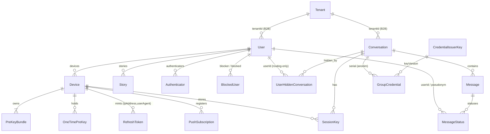

# 28 — Threat Model: DB Dump (menuju ZK sesungguhnya)

> **Status:** AUDIT + RENCANA. Belum ada perubahan kode dari dokumen ini.
> Baseline: `main` @ `2464f23f` (2026-10-08). Fokus permintaan: **privasi ekstrem —
> apa bahaya terburuk bila database di-dump**, lalu apa yang masih harus diubah.
>
> Aturan yang TIDAK boleh dilanggar oleh rencana ini: format kripto beku
> (`ENC1:`, amplop XChaCha `base64url(nonce(24)||ct)`, `ENCRYPT_DATA` array
> angka, padding 8KB, opcode transport, skema tempId). Lihat docs 03/04/05.

## 28.0 Skenario musuh (yang harus tahan)

| Kode | Kemampuan musuh | Contoh nyata |
|---|---|---|
| **A1** | Baca `pg_dump` / snapshot disk / backup yang bocor. **Read-only**, tidak bisa menulis DB, tidak bisa memanggil API. | Backup harian `/root/backups/` bocor, snapshot VPS dicuri, dump diberi ke vendor/penegak hukum |
| **A2** | A1 **+ akses jaringan/API** (bisa memakai rahasia yang ditemukan untuk memanggil endpoint) | Dump bocor + penyerang punya akun sendiri |
| **A3** | Dump **+ tulis DB** (mis. kompromi kredensial root DB) | SQL injection massal, VPS takeover |
| **A4** | Dump **+ kunci privat issuer/konten** | Kombinasi dengan kebocoran env |

Kripto NYX sudah dirancang untuk tahan **A1** terhadap *isi pesan* (server hanya
memegang ciphertext E2EE; masterSeed tidak pernah ke server). Dokumen ini mengukur
apa yang **masih** bocor padahal isi pesan aman: **graph sosial, rahasia otoritas,
dan metadata temporal.**

## 28.1 Inventaris — 17 tabel & perannya



Catatan: `Message.senderId` **bukan** FK (pseudonym untuk grup v2, `NULL` untuk
1:1). `MessageStatus.userId` dan `UserHiddenConversation.userId` juga bukan FK ke
`User` di skema Prisma, tetapi keduanya diisi **userId asli** pada jalur 1:1
(lihat D2).

| Tabel | Isi | Bisakah server membacanya? |
|---|---|---|
| `User` | `usernameHash` (blind index), `passwordHash`, `encryptedProfile`, `encryptedContactBundle`, role/ban/subscription, `lastActiveAt`, `autoDestructDays`, `externalId` | Sebagian: blob opaque aman; blind index + metadata tidak |
| `Tenant` | `name`, `apiKey` (plaintext), `allowedDomains` | Ya (plaintext) |
| `Device` | public keys (X25519/ML-KEM/Ed25519), `fingerprint`, `installationId`, `name` | Ya — identifier perangkat |
| `PreKeyBundle`, `OneTimePreKey` | material publik PQX3DH | Ya (memang publik) |
| `RefreshToken` | `jti`, `familyId`, `ipAddress`, `userAgent`, `deviceId`, rantai rotasi | Ya — metadata sesi |
| `SessionKey` | `encryptedKey`, `initiatorCiphertexts` (terenkripsi masterSeed) | Tidak (opaque) — tapi graph sesi terlihat |
| `PushSubscription` | `endpoint`, `p256dh`, `auth`, `deviceId` | Ya — identifier perangkat push |
| `Conversation` | `isGroup`, `encryptedMetadata`, `authSecret` (plaintext), `adminSecretHash`, `lastMessageAt`, `metadata` (JSON tenant) | Ya untuk `authSecret` & timestamp |
| `Message` | `content` (ciphertext E2EE), `deleteSecret` (plaintext), `senderId` (pseudonym/NULL), `sessionId`, `repliedToId`, `isViewOnce/isViewed`, `createdAt`, `expiresAt` | Ciphertext tidak; secret & metadata ya |
| `MessageStatus` | `userId` (asli untuk 1:1), `status`, `updatedAt` | Ya — pembaca + waktu baca |
| `UserHiddenConversation` | `userId` (asli, routing-only), `deliveryToken` | Ya — keanggotaan grup |
| `GroupCredential` | `serial` (64-hex), `conversationId`, `keyVersion` | Ya — tanpa identitas (desainnya sudah benar) |
| `CredentialIssuerKey` | `publicKeyJwk`, **`privateKeyPkcs8` (PLAINTEXT)** | Ya — **akar kepercayaan** |
| `Authenticator` | `credentialID`, `credentialPublicKey`, `counter`, `transports`, `credentialDeviceType` | Ya — perangkat/biometrik |
| `BlockedUser` | `blockerId`, `blockedId` | Ya — edge sosial eksplisit |
| `Story` | `senderId` (FK!), `encryptedPayload`, `expiresAt` | Author↔story terlihat |

## 28.2 Apa yang bisa direkonstruksi dari dump (A1)

Yang **tidak** bisa: isi pesan/story/profil, kunci privat, session key (terenkripsi
masterSeed), kontak (opaque bundle).

Yang **bisa** — inilah bahayanya, diurutkan dari terburuk:

1. **Graph sosial penuh 1:1 dan grup.** Bukan dari `senderId` (sudah `NULL`/pseudonym),
   tetapi dari pasangan `MessageStatus.userId` + `UserHiddenConversation.userId` +
   `Message.conversationId`. Hasilnya: "A dan B punya percakapan", "C ada di grup G",
   plus **siapa membaca pesan apa, kapan**.
2. **Peta perangkat & sesi.** `Device` (nama perangkat, fingerprint, installationId),
   `RefreshToken` (IP-hash, userAgent, rantai rotasi), `PushSubscription`
   (`endpoint` FCM/APNs), `Authenticator`. → satu manusia = N perangkat, dengan
   identifier yang tahan clear-cookie.
3. **Pola waktu/traffic analysis.** `Message.createdAt` (+ `expiresAt`,
   `isViewOnce`, `isViewed`, `repliedToId`, `sessionId`), `Conversation.lastMessageAt`,
   `Device/User.lastActiveAt`, `Authenticator.counter`, `OneTimePreKey.createdAt`.
   → siapa aktif kapan, siapa membalas siapa, kecepatan balasan, kapan grup ramai.
4. **Rahasia otoritas (langsung bisa dipakai bila A2):** `CredentialIssuerKey.privateKeyPkcs8`,
   `Conversation.authSecret`, `Message.deleteSecret`, `Tenant.apiKey`.
5. **Deanonymisasi identifier:** `usernameHash`, IP-hash, `Device.fingerprint`
   (semuanya hash **tanpa kunci** atas input berentropi rendah → reversibel).

## 28.3 Temuan

Severity: **KRITIS** (langsung membuka akses / memalsukan identitas), **TINGGI**
(deanonimisasi terarah / graph), **SEDANG** (metadata & korrelasi), **RENDAH**
(graph tanpa identitas / material publik).

### D1 — KRITIS: kunci privat issuer grup ada di dalam DB
`CredentialIssuerKey.privateKeyPkcs8` disimpan plaintext di kolom DB
(`server/prisma/schema.prisma`, model `CredentialIssuerKey`; komentar: "prod:
backup terenkripsi"). Presentasi credential = verifikasi tanda tangan issuer +
serial terdaftar untuk conversation (`server/src/lib/groupCredentials.ts:132-160`),
dan serial di-commit oleh klien (`server/src/routes/conversations.ts:110-128`).

**Bahaya terburuk:** pemegang dump bisa memalsukan credential untuk grup mana pun;
dengan A3 (tulis DB) atau A2 (akun sendiri + commit serial) → **masuk grup tanpa
diundang / mengaku anggota**. Ini satu-satunya item yang *secara langsung*
mematahkan jaminan privasi grup — bukan cuma kebocoran informasi.
**Target:** kunci privat keluar dari DB (env/KMS/file 0600), kolom dihapus setelah migrasi.

### D2 — KRITIS: penghapusan `senderId` belum menghapus edge 1:1
`Message.senderId` sudah `NULL` untuk 1:1 dan pseudonym untuk grup v2 — benar.
Tapi:
- `MessageStatus.userId` menyimpan **userId asli** untuk 1:1: `persistedReaderId =
  msg.conversation.isGroup && readerPseudonym ? readerPseudonym : userId`
  (`server/src/network/realtimeHandlers.ts:816`, upsert di `:824`).
- `UserHiddenConversation.userId` menyimpan **userId asli** setiap anggota yang
  mengirim token: `server/src/routes/messages.ts:237-241`,
  `server/src/routes/conversations.ts:365-369`, `server/src/network/realtimeHandlers.ts:300-304`.

**Bahaya terburuk:** dump memberi graph "A↔B" yang lengkap (siapa lawan bicara
siapa, kapan pesan dibaca) — sehingga efek privasi = setara sebelum penonimaan
`senderId`. Untuk "ZK sesungguhnya", **timbal balik receipt 1:1 harus dibutakan
juga**, dan `UserHiddenConversation.userId` harus berhenti menyimpan identitas asli.

### D3 — TINGGI: rahasia otoritas plaintext (authSecret & deleteSecret)
- `Conversation.authSecret` = `crypto.randomBytes(32).toString('hex')`, plaintext
  (`server/src/routes/conversations.ts:299`), dipakai sebagai bearer token untuk
  operasi grup (`:145`, `:403`, `:431`, `:477`, `:503`).
- `Message.deleteSecret` plaintext (`server/src/network/realtimeHandlers.ts:254`),
  diotorisasi dengan `safeEqualStrings` (`server/src/routes/messages.ts:268-278`).

**Bahaya terburuk (A2):** ikut bicara di grup mana pun, menghapus/unsend pesan
milik orang lain (integritas + availability). Catatan: `adminSecretHash` **sudah
benar** (SHA-256 dari token 256-bit, tidak bisa di-brute force dari dump) — pola
yang sama seharusnya dipakai untuk `authSecret`/`deleteSecret`
(**hash di DB, klien tetap memegang token asli**).

### D4 — TINGGI: `Tenant.apiKey` plaintext + identitas B2B
`apiKey` plaintext + `Tenant.allowedDomains` + `User.externalId` +
`Conversation.metadata` (JSON bebas dari tenant, `server/src/routes/engine.ts:99`).
**Bahaya terburuk:** dump = akses penuh API B2B (mint user, buat room, keluarkan
URL iframe bertoken) dan deanonymisasi pelanggan B2B lewat `externalId` yang justru
identitas asli mereka. `metadata` bisa memuat plaintext apa pun yang ditulis tenant.

### D5 — TINGGI: "hash IP" reversibel + `userAgent` plaintext
```ts
// server/src/routes/auth.ts:82 (juga :510, engine.ts:44; bandingkan sessions.ts:61)
sodium.to_hex(sodium.crypto_generichash(32, Buffer.from(rawIp), null)).substring(0, 16)
```
Hash **tanpa kunci** (BLAKE2b kunci `null`) atas input rendah-entropi, lalu dipotong
8 byte. IPv4 hanya 2³² kemungkinan → enumerasi penuh praktis. `userAgent` disimpan
**plaintext** (`auth.ts:108`, `engine.ts:48`).
**Bahaya terburuk:** dump + data ASN/geo = "siapa terhubung dari jaringan mana",
pelacakan lintas akun (IP kafe = beberapa user), dan fingerprint OS/browser presisi.

### D6 — TINGGI: `usernameHash` reversibel (Argon2id salt statis, params publik)
```ts
// web/src/workers/crypto.worker.ts:1318-1328
const SALT = new TextEncoder().encode("NYX_BLIND_IDX_V1");
argon2id({ password: username.toLowerCase(), salt: SALT, ...ARGON_INDEX_CONFIG })
// ARGON_INDEX_CONFIG: memorySize 64 MB, iterations 3, parallelism 1 (baris 54-60)
```
Salt **statis** + parameter ada di bundel klien (publik) ⇒ satu rainbow table
berlaku global untuk semua deployment. Entropi username manusia rendah ⇒ dump
ditambah kamus username → deanonymisasi. `usernameHash` juga beredar di link
undangan (`?u=<usernameHash>`, `web/src/components/ShareProfileModal.tsx:33`).

**Referensi Signal (dicek di `~/signal`):** plaintext username **tidak pernah**
disimpan; server menyimpan `username_hash` 32 byte dan membuktikan pengetahuan
username dengan **ZK proof** (`Signal-Server/.../util/UsernameHashZkProofVerifier.java`,
`libsignal` `Username.verifyProof`). Hash-nya memuat komponen acak
(nickname+discriminator) sehingga tidak ada kamus yang menembusnya.

**Fix minimal NYX tanpa mengubah UX:** beri **pepper server-side**
(`HMAC(pepper, argonHash)` saat simpan & lookup, pepper di env — **tidak** di DB).
Klien tidak perlu berubah; tanpa pepper, dump tidak bisa membangun rainbow table.
(Migrasi: baca dual — cocokkan legacy, lalu tulis ulang baris saat login.)

### D7 — TINGGI: `Device.fingerprint` = pseudo-identifier perangkat yang stabil
```ts
// web/src/utils/fingerprint.ts:11-31
signals = [userAgent, language, timezoneOffset, colorDepth, screenWxH,
           hardwareConcurrency, deviceMemory, maxTouchPoints, availWxH].join('|')
// SHA-256 tanpa kunci → hex (fallback djb2 kalau crypto.subtle diblokir)
```
Disimpan di `Device.fingerprint` + `Device.installationId`
(`server/src/routes/auth.ts:224-225`, `:315-316`; `routes/users.ts:362-363`) dan
dipakai untuk binding percobaan login (`auth.ts:346-355`).
**Bahaya terburuk:** kolom ini adalah **sidik jari perangkat**, bukan rahasia —
A1 bisa mencocokkan "device sama" lintas akun, dan karena inputnya rendah-entropi,
hash-nya juga reversibel (enumerasi kombinasi UA/screen). Ini kontradiksi langsung
dengan narasi "server tidak mengenal perangkatmu".

### D8 — SEDANG: `Story.senderId` adalah FK asli
`server/src/routes/stories.ts:57-63` (`senderId: userId`), TTL 24 jam +
sweeper (`server/src/jobs/systemSweeper.ts:92`).
**Bahaya:** "siapa membuat story kapan" tanpa perlu membuka isi; dengan D2, story
melengkapi graph aktivitas. Pola token (seperti grup) belum dipakai di sini.

### D9 — SEDANG: `BlockedUser` = edge sosial eksplisit
`(blockerId, blockedId)` unique. **Bahaya:** daftar permusuhan/hubungan privasi —
justru graph yang paling ingin disembunyikan orang. Bisa diganti pasangan token
tak-terkait (HMAC dengan pepper + salt per relasi).

### D10 — SEDANG: `PushSubscription`
`endpoint` unik + `p256dh`/`auth` per `Device`. **Bahaya:** identifier perangkat
FCM/APNs (nomor serial perangkat), dan bila VAPID private key juga bocor (env),
penyerang bisa mengirim push yang tampak berasal dari NYX. Endpoint juga
memungkinkan pelacakan perangkat lintas akun.

### D11 — SEDANG: metadata temporal/kuantitatif
`Message.createdAt/expiresAt/isViewOnce/isViewed/sessionId/repliedToId`,
`Conversation.lastMessageAt/createdAt/isGroup`, `Device/User.lastActiveAt`,
`Authenticator.counter`, `OneTimePreKey.createdAt`, id `cuid()` yang time-ordered.
**Bahaya:** analisis trafik kelas tinggi (siapa aktif, siapa membalas cepat,
grup mana yang ramai, kapan berhenti), plus `isGroup` mengklasifikasi percakapan
tanpa membuka isi. Padding 8KB melindungi **ukuran pesan di wire**, bukan pola
temporal di DB.

### D12 — RENDAH/CATATAN: `GroupCredential.serial`
`serial = SHA-384(prepared message)` (`server/src/lib/groupCredentials.ts:95`),
tidak membawa identitas — desain sudah benar. Risiko tersisa: serial yang bocor
dari log/klien = bukti keanggotaan (presentasi). Pastikan serial tidak pernah
masuk log.

### D13 — RENDAH: material kunci publik
`PreKeyBundle`/`OneTimePreKey` memang publik; `SessionKey.encryptedKey`/
`initiatorCiphertexts` terenkripsi masterSeed (server tak bisa baca). Yang tersisa
hanya graph "device X punya sesi di conversation C" — layak dicatat, bukan prioritas.

### D14 — SEDANG (bukan DB, tapi satu dump/leak): Redis
- `online_users` = SET berisi **userId asli**, dan daftar lengkapnya
  **di-broadcast ke setiap user yang connect** (`type:'bulk'`,
  `server/src/network/realtimeHandlers.ts:328-341`; cleanup di
  `redisBridge.ts:270-274`). Artinya **setiap klien NYX bisa memanen roster online
  seluruh platform** — ini graph presensi, dan tidak butuh dump sama sekali.
- `linking_token:<t>` = `{userId, deviceId}` 300s, `active_device:<userId>`,
  `cache:keys:*`, key rate-limit. Redis persisten (AOF di roadmap 27.1) = artefak
  setara DB.

## 28.4 Yang sudah benar — jangan diregresikan

- `Message.senderId` `NULL` (1:1 / sealed sender) & pseudonym (grup v2/T1).
- Token-first membership (`UserHiddenConversation.deliveryToken` unik, wajib
  diterbitkan klien) — discovery = kepemilikan token.
- `Conversation.adminSecretHash` = hash dari token 256-bit (pola benar).
- Isi pesan/story/profil/kontak = opaque (E2EE); `passwordHash` Argon2id
  per-user salt; `SessionKey` terenkripsi masterSeed.
- TTL: pesan default 14 hari, story 24 jam, sweepers berjalan.
- `GroupCredential` tidak menyimpan identitas.

## 28.5 Rencana bertingkat

Setiap tier berdiri sendiri dan bisa di-commit terpisah.

### Tier 0 — operabilitas & rahasia (tanpa perubahan protokol klien)
| # | Perubahan | Acceptance |
|---|---|---|
| 0.1 | Pindahkan `CredentialIssuerKey.privateKeyPkcs8` ke env (`GROUP_ISSUER_KEY_PKCS8`) / file 0600; baca env dulu, fallback kolom selama transisi; migrasi + `ALTER TABLE ... DROP COLUMN` setelah aman (db push) | `rg privateKeyPkcs8 server/prisma` kosong; test issuing credential tetap lulus; dump tanpa kolom kunci tidak bisa menandatangani |
| 0.2 | Pepper server-side untuk blind index: simpan `HMAC(USERNAME_INDEX_PEPPER, clientHash)`; lookup pakai nilai ter-pepper; dual-read legacy lalu upgrade baris | login user lama tetap sukses (test); dump tanpa pepper tidak bisa membangun rainbow table |
| 0.3 | Berhenti menyimpan `RefreshToken.ipAddress` + `userAgent` (atau `HMAC(pepper, ip)` saja); tampilkan sesi saat ini dari token, bukan dari perbandingan IP | `sessions.ts` tetap menandai sesi aktif; tidak ada kolom IP plaintext/hash-tanpa-kunci |
| 0.4 | `Device.fingerprint` → `HMAC(pepper, fingerprint)` (tetap deterministik untuk binding) atau hapus kolom; nilai mentah tak pernah persist | login device lama tetap lolos (test); dump tidak memuat sidik jari perangkat |
| 0.5 | `Tenant.apiKey` → `apiKeyHash` (SHA-256, tampilkan sekali saat dibuat); dokumentasikan larangan plaintext di `Conversation.metadata` | engine/embed tetap jalan (test tenantAuth) |
| 0.6 | Hapus `deleteSecret` plaintext → simpan `deleteSecretHash` (SHA-256); `authSecret` → `authSecretHash` | unsend/delete grup & operasi grup tetap lulus test parity |
| 0.7 | Hentikan broadcast `online_users` penuh; presence jadi per-kontak/query (lihat 1.4) | tidak ada lagi SET berisi seluruh userId; test realtime disesuaikan |

Risiko Tier 0: rendah — semua perubahan **server-side**, klien tidak berubah
(kecuali 0.6 bila klien mengirim secret plaintext: tetap dikirim, server yang men-hash).

### Tier 1 — linkability struktural (menyentuh kontrak payload/klien)
| # | Perubahan | Catatan risiko |
|---|---|---|
| 1.1 | Receipt 1:1 dibutakan: klien mengirim receipt token (pseudonym) untuk `MessageStatus.userId`; notifikasi tetap via `targetRecipient` | Butuh sinkronisasi web+server+docs; `mark_as_read`/`view_once` ikut jalur ini |
| 1.2 | `UserHiddenConversation.userId` → `routeTag` opaque (mis. `HMAC(pepper, conversationId‖userId)`) atau dihapus; audit dulu semua pembaca kolom ini (push, sweeper, listing) | Wajib audit pemakaian; listing "conversation saya" sudah berbasis token |
| 1.3 | `Story.senderId` → token pembuat story (pola grup) | Endpoint `GET /stories/:userId` ikut berubah |
| 1.4 | `BlockedUser` → pasangan token opaque | Endpoint blockedUsers berubah |
| 1.5 | Presence: langganan per-kontak, bukan roster global | Perubahan produk (status online jadi lazy/opt-in) |

### Tier 2 — metadata/temporal
- 2.1 Bucketing `createdAt`/`lastActiveAt` (mis. 15 menit) untuk kolom yang tidak
  dipakai fungsional presisi; hapus `Conversation.lastMessageAt` (derivasi dari
  `MAX(Message.createdAt)`).
- 2.2 `Message.repliedToId`: simpan sebagai hash/opaque, atau andalkan ciphertext.
- 2.3 Pertimbangkan `Authenticator.counter` (dipakai untuk clone-detection
  WebAuthn — tradeoff privasi vs keamanan; putuskan sadar).
- 2.4 Pastikan OTPK dihapus tepat saat dipakai (row habis = tidak ada riwayat).

### Tier 3 — guardrail & pembuktian
- 3.1 `server/tests/schemaPrivacy.test.ts`: assertion daftar-kolom-terlarang di
  `schema.prisma` (ipAddress, userAgent, senderId FK, apiKey plaintext, …) → CI
  gagal bila ada regresi.
- 3.2 "Dump simulator" (script opsional): seed DB → jalankan alur 1:1 + grup →
  `pg_dump` → jalankan query assertion bahwa pasangan (user,user) tidak bisa
  direkonstruksi. Ini mengubah klaim privasi dari argumen menjadi **bukti**.

## 28.6 Keputusan yang dibutuhkan dari maintainer

1. **Tier mana dulu?** Rekomendasi: **Tier 0 lengkap** (murah, tanpa risiko klien,
   langsung menghapus item KRITIS D1 + TINGGI D3/D4/D5/D6/D7), lalu 1.1 + 1.2
   (menutup D2 — inti "ZK sesungguhnya").
2. **Presence (D14/1.5):** boleh diubah jadi per-kontak (mengubah UX), atau tetap
   global demi kesederhanaan?
3. **`Authenticator.counter` (2.3):** privasi vs deteksi kloning authenticator.
4. **`Device.fingerprint` (0.4):** tetap dipakai untuk anti-spam (dengan pepper)
   atau dihapus total?

## 28.7 Status artefak

- Audit ini: `docs/28-db-dump-threat-model.md` (baru).
- Baseline sebelum implementasi: server 109/109, web 267/267, `tsc` web+server
  0 error, build web 0 (`main` @ `2464f23f`).

## 28.8 Progress Tier 0 (implementasi)

Keputusan maintainer (2026-10-08): kerjakan **Tier 0 penuh + 1.1 & 1.2**, dan
presence menjadi **per-kontak/langganan**.

**Sudah mendarat — "rahasia & identifier at-rest" (0.1, 0.3, 0.4, 0.5, 0.6):**

| # | Temuan | Perubahan |
|---|---|---|
| 0.1 | D1 KRITIS | `CredentialIssuerKey.privateKeyPkcs8` **dihapus dari schema**; private key dari env `GROUP_ISSUER_KEY_PKCS8` (dev: file `server/.nyx-issuer-key` 0600, dibuat otomatis non-production, gitignored). Row DB hanya `publicKeyJwk` + `keyVersion`; mismatch env↔DB = fail fast; production tanpa env = fail-closed. Script: `pnpm --filter nyx-server run issuer-key:generate` / `issuer-key:export` (ekspor kolom legacy via raw SQL — jalankan SEBELUM drop kolom) |
| 0.3 | D5 | `RefreshToken.ipAddress` & `userAgent` **dihapus** dari schema + semua jalur tulis (auth issueTokens, refresh, engine iframe). `GET /api/sessions` memakai `Device.name` + `isCurrent`; UI sesi ikut disesuaikan (dedupe per `deviceId`, bukan UA) |
| 0.4 | D7 | `Device.fingerprint` disimpan ter-index (`HMAC(pepper, fingerprint)`): auth register/login/recovery, `PUT /api/users/keys`, dan cek hardware-binding di `redisBridge` |
| 0.5 | D4 | `Tenant.apiKey` disimpan **sealed** (AEAD deterministik) → lookup tetap jalan; admin tetap melihat key asli (di-unseal di endpoint admin-only, key asli dikembalikan sekali saat create) |
| 0.6 | D3 | `Conversation.authSecret` & `Message.deleteSecret` kini **hash SHA-256** (pola `adminSecretHash`), dibandingkan dual-mode (`credentialTokenMatches`) sehingga baris legacy plaintext tetap berfungsi |

Helper tunggal: `server/src/utils/atRestSecrets.ts` (pepper, `pepperedIdentifier`,
`hashCredentialToken`, `credentialTokenMatches`, `sealAtRest`/`openAtRest`).
Semua pepper/key berasal dari env `NYX_AT_REST_PEPPER` (production: wajib).

**Belum mendarat (urutan yang direncanakan):**

| # | Item | Catatan |
|---|---|---|
| 0.2 ✅ | Pepper blind index `usernameHash` | **Mendarat.** Register menyimpan `HMAC(pepper, argonKlien)`; login/recovery-verify/register-check/pencarian user memakai kandidat `[ter-pepper, apa adanya]` (`findFirst` + `in`), jadi klien & baris legacy tidak berubah. Nonce recovery di-key oleh identifier ter-pepper (Redis juga tidak memuat identifier mentah) dengan fallback kandidat. `isExactHash` menerima 43-char base64url (Argon2id klien) **dan** 64-hex (nilai ter-index yang di-echo server) sehingga link undangan hasil-echo tetap bisa dipakai mencari kontak. `engine.ts` (user B2B) ikut ter-pepper. Test: `tests/usernameBlindIndex.test.ts` (5 test: properti privasi + wiring). |
| 0.7 ✅ | Presence per-kontak | **Mendarat.** Snapshot `{type:'bulk'}` dan broadcast `join`/`leave` kini hanya memuat **peer** (user yang berbagi conversation), bukan seluruh isi `online_users`. Peer diturunkan server dari `UserHiddenConversation` (`utils/presencePeers.ts`), **bukan** deklarasi klien — jadi tidak ada pertukaran bocor baru (minta klien mengirim daftar kontaknya = kebocoran baru). Disconnect (`handleDisconnect`) memakai jalur yang sama + `try/catch` supaya kegagalan DB tidak menggagalkan pembersihan koneksi. Klien: store conversation meminta refresh presence setelah membuat grup supaya badge anggota baru langsung terisi; jalur lain menyusul pada presence refresh/connect berikutnya (batasan disadari). Test: `tests/presencePeers.test.ts` (7 test). |
| 1.1 ✅ | Blind receipt 1:1 | **Mendarat.** Di jalur 1:1 & grup v1, `MessageStatus.userId` kini diisi **tag opaque turunan server** (`conversationScopedTag` = `HMAC(pepper, "receipt:<conversationId>:<userId>")`) — bukan userId asli, dan **bukan** nilai dari klien (kalau klien bisa memilih, ia bisa memalsukan receipt atas nama user lain). Sifat tag: deterministik per (conversation, user) → upsert/guard TTL tetap idempoten; berbeda antar percakapan → tak bisa mengkorelasikan pembaca lintas chat; tak bisa dibalik tanpa pepper. Klien: di 1:1 pencocokan status tidak lagi bisa memakai identitas (server tidak menyimpannya) — UI/guard kini memperlakukan status di 1:1 sebagai milik satu-satunya peer (`MessageItem` tick + guard receipt, `ChatWindow` `unreadVisible`), sedangkan logika pseudonym grup tidak berubah. Test: 2 kontrak lama di `realtimeHandlers.test.ts` diperbarui (perilaku memang berubah) + guard regresi baru. |
| 1.2 ⏳ | `UserHiddenConversation.userId` | Belum. Rencana: routing identity ter-seal (`sealAtRest`, sudah tersedia) supaya push/sweeper/broadcast profil tetap jalan tapi dump DB tak membuka keanggotaan; pembaca kolom sudah diaudit (messageSweeper, users.ts broadcast, kick/leave revoke, count anggota, kunci upsert) |

**Residual yang disadari (belum ditutup, catat jujur):** `Device.installationId`
(random, tak bisa dibalik, tapi bisa dikorelasikan *di dalam* dump),
`Device.name` (label platform yang di-set klien), `User.externalId` (identitas
B2B dari tenant), dan `MessageStatus.userId` untuk 1:1 (→ ditutup oleh 1.1).

Catatan 0.2: nilai `usernameHash` yang dikirim server ke klien kini bentuk
ter-index — ia ikut di link undangan (`?u=`) dan di-echo pada flow recovery.
Efek privasi: link tidak lagi bisa dibalik ke username tanpa pepper (yang perlu
dibandingkan dengan sebelum: Argon2id salt statis = rainbow table global).
Efek yang tersisa: nilai itu tetap **identifier stabil** antar penerima link
(pseudonim publik), sama seperti sebelumnya — bukan penurunan privasi baru.

**Urutan operasi produksi (0.1):** (1) `issuer-key:export` → simpan ke
`/root/nyx-app/.env`; (2) restart `nyx-api`; (3) verifikasi issuance credential
grup; (4) baru `prisma db push` yang menghapus kolom `privateKeyPkcs8`.
`GROUP_ISSUER_KEY_PKCS8` ikut ditambahkan ke `.env.example` (root + server).
