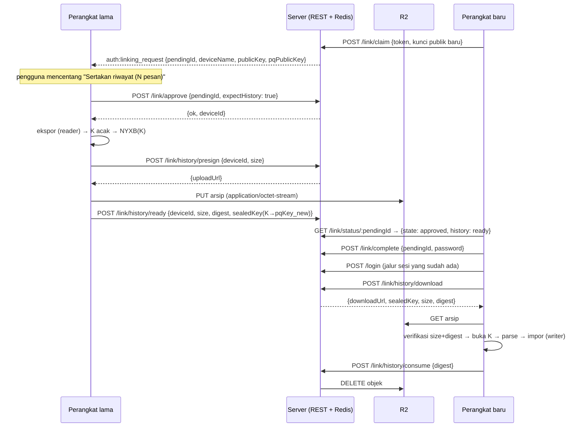

# 40 — Arsip Riwayat Sekali-Pakai untuk Perangkat Hasil Link

> **Status: FASE 0–2 LANDED (2026-10-29).** Yang sudah berjalan di kode: kirim
> `pqPublicKey` di `auth:linking_request`, gerbang `history` di status/approve,
> `/abort`, enam endpoint arsip, ekspor **kontak + daftar percakapan + pesan**,
> impor bertahap (batch 250, progres UI), `pushContactBundle` setelah impor, dan
> e2e nyata yang membaca ulang pesan dengan kunci vault identitas baru. File:
> `server/src/utils/linkHistory.ts`, `server/src/utils/linkHistoryObject.ts`,
> `server/src/routes/linkHistory.ts`, `web/src/lib/linkHistory{Client,Export,Import}.ts`.
> Termasuk percobaan ulang: kegagalan impor ditandai di `kvStore`
> (`nyx_link_history_pending`, boolean tanpa timestamp), satu percobaan otomatis saat app start, dan
> tombol "Ambil riwayat dari perangkat sebelumnya" di Settings → Active Sessions
> (`web/src/lib/linkHistoryRetry.ts`). Belum dikerjakan: `groupCachedParticipants`
> di arsip dan benchmark 10k pesan.
>
> Tidak ada format beku yang berubah: arsip memakai kontainer `NYXB` v1 apa
> adanya dengan **kunci acak** (bukan turunan recovery phrase), dan tidak ada
> tabel DB baru.
>
> Konteks: `docs/14` §14.10 (alur `/link`), `docs/31` (format `.nyxbak`),
> `docs/28` (ancaman dump DB). Pengganti konsep "transfer vault lewat QR"
> (`migration:*`) yang **dihapus 2026-10-29**.

---

## 40.1 Masalah

Link perangkat (`/link`, 2026-10-18) membuat **identitas baru**: perangkat baru
memanggil `registerAndGenerateKeys(password)` sendiri (`web/src/pages/LinkDevicePage.tsx`),
lalu `POST /api/auth/link/claim` mengirim **kunci publik** perangkat itu ke
perangkat lama. Server membuat `Device` row baru dan menerbitkan entri KT.

Akibatnya, setelah link berhasil:

| Yang diharapkan pengguna | Kenyataan hari ini |
|---|---|
| Riwayat chat ikut | Kosong. `docs/14` §14.10 menyebutnya eksplisit: "starts with a fresh identity and **no** history" |
| Kontak ikut | Kosong **dan** bundle kontak di server (`User.encryptedContactBundle`) tidak bisa dibuka lagi (lihat §40.2 temuan 2) |
| Lampiran lama bisa dibuka | Tidak, karena baris pesan (termasuk `fileKey`) tidak ada |

Tujuan desain: satu arsip riwayat yang **ditujukan ke satu perangkat** (hasil
link), **sekali pakai**, **tidak bisa dibaca server**, dengan jendela waktu
terbatas. Bukan multi-device: NYX tetap satu akun satu sesi aktif.

---

## 40.2 Tiga temuan kode yang menentukan desain

### Temuan 1 — isi pesan disegel dengan kunci vault turunan *private key identitas*, bukan `masterSeed`

`web/src/lib/shadowVaultDb.ts` menurunkan kunci vault:

```ts
const getVaultKey = async () => {
  const { privateKey } = await getMyEncryptionKeyPair();
  const key = sodium.crypto_generichash(32, privateKey, null); // BLAKE2b-256
  ...
};
```

`content`, `repliedTo`, `senderName/Username/AvatarUrl`, `fileMeta`, `participants`,
`decryptedMetadata` — semuanya `encryptVaultText` (kunci vault). `ENC1:`
(`masterSeed`) hanya untuk kolom struktur (`seq`, `expiresAt`, `autoDelete`,
`reactions`, `statuses`, dan state ratchet/grup).

Konsekuensi: perangkat hasil link punya **private key identitas baru**, jadi
menyalin baris `messages`/`conversations` apa adanya menghasilkan riwayat yang
tampil **kosong** (dekripsi gagal per baris), tanpa error yang jelas.

Itulah bedanya dengan `.nyxbak`: restore berhasil karena recovery phrase
mereproduksi `masterSeed` **dan** private key yang sama (`restoreFromPhrase`).
Di link, tidak ada phrase yang diketik — perangkat baru membuat identitas baru.

### Temuan 2 — kontak juga vault-keyed, termasuk salinan di server

`web/src/lib/contactStore.ts` menyegel seluruh record kontak dengan
`encryptVaultText` dan mengunggah `encryptedBundle` ke
`PUT /api/users/me/contact-bundle` dengan kunci yang sama. Setelah identitas
berganti, bundle lama di server **tidak bisa dibuka** perangkat baru
(`restoreContactsFromBundle` → "Bundle korup/tak dikenal", gagal senyap).

Celah ini **sudah ada** hari ini, bukan sesuatu yang diperkenalkan desain ini.

**Status 2026-10-29 (sudah diperbaiki sebagian):** alur link kini memanggil
`replaceContactBundleWithLocal()` setelah `login()` dan sebelum navigasi, jadi
blob mati itu tidak lagi tersimpan — perangkat hasil link menulis ulang bundle
dari identitasnya sendiri (biasanya daftar kosong) dan restore berikutnya tidak
mencetak "Bundle korup". Yang tetap belum kembali adalah **isi** kontak lama;
itu bagian arsip ini (§40.8 langkah 6).

### Temuan 3 — kontainer arsip sudah menerima kunci acak

`CreateBackupOptions.key` di `web/src/lib/backupRestore.ts` didokumentasikan
sebagai *"Kunci backup 32 byte (acak untuk transfer, atau `deriveBackupKey`
untuk berkas)"*. Jadi arsip berkunci-acak tidak menuntut perubahan format,
versi, atau AAD. Yang berubah hanya **asal kunci** dan **bentuk payload**.

Kesimpulan desain: **ekspor lewat pembaca yang mendekripsi, impor lewat penulis
yang menyegel ulang.** Tidak ada peta kolom baru yang harus dijaga manual, dan
tidak ada kunci privat/kunci sesi yang menyeberang.

---

## 40.3 Properti yang dijanjikan

| Properti | Bagaimana |
|---|---|
| Ditujukan ke satu perangkat | Kunci arsip `K` (32 B acak) diseal ke **X-Wing public key** perangkat baru (`pq_box_seal_v2`, envelope `NYS2`) |
| Tidak bisa dibaca server | Server hanya menyimpan pointer: `sealedKey` (ciphertext), `size`, `digest`. Isi arsip AEAD dengan `K` |
| Sekali pakai | Objek R2 dihapus saat `consume` (setelah impor sukses); state Redis TTL 30 menit; lifecycle rule `link-history/` sebagai jaring |
| Hanya perangkat itu yang bisa mengunduh | Endpoint unduh memakai sesi; `req.deviceId` sendiri yang jadi nama state (tanpa parameter id yang bisa ditebak) |
| Jendela sempit | Objek hanya boleh diunggah perangkat yang baru dibuat (≤30 menit), dan hanya bisa diambil ≤30 menit setelah `ready` |
| Riwayat tetap bisa dibaca | Isi diarsipkan sebagai **objek domain** (`Message`, `Conversation`, kontak) yang sudah didekripsi, lalu disegel ulang dengan kunci perangkat baru saat impor |
| Tidak menduplikasi logika kripto | Ekspor memakai pembaca yang ada; impor memakai penulis yang ada (`upsertMessages`, `saveConversation`, `encryptRecord`) |

Yang **tidak** dijanjikan: kerahasiaan dari server tentang *ukuran* arsip dan
*waktu* transfer (bocor lewat `size` dan timing), dan kerahasiaan dari perangkat
lama (dialah sumbernya).

---

## 40.4 Alur



### Gerbang `history` (penting)

Perangkat lama ter-logout **begitu** perangkat baru login (satu device aktif).
Kalau perangkat baru langsung memanggil `complete` setelah `approve`, unggahan
yang lambat akan terpotong oleh pencabutan sesi.

Karena itu `approve` menerima `expectHistory: true`, dan
`GET /link/status/:id` mengembalikan tambahan:

```json
{ "state": "approved", "history": "preparing" | "ready" | "none" }
```

`LinkDevicePage.waitForApproval` menunggu `history !== "preparing"` sebelum
memanggil `complete`, dengan batas 60 detik (lalu lanjut tanpa riwayat; objek
yang telat menjadi yatim dan dihapus lifecycle rule). Tanpa centang, `history`
langsung `none` dan tidak ada penundaan.

---

## 40.5 Format & kripto

| Elemen | Nilai |
|---|---|
| Kontainer | `NYXB` v1, header 32 B, frame AEAD, AAD `nyxb:v1:<type>:<index>:<count>` — **tidak berubah** |
| Kunci isi `K` | 32 byte acak (`random_bytes`), hanya hidup di memori perangkat lama |
| Panjang frame | Padding 1024 B yang sudah ada (ukuran total menyembunyikan panjang per pesan) |
| Salt header | 16 byte acak (tidak dipakai jalur `K`; ditulis tetap agar header valid) |
| `scramble` | `true` — frame bertipe sama tidak tersusun menurut struktur sosial |
| `digest` | BLAKE2b-256 atas byte arsip final, hex 64 |
| Pembungkus kunci | `pq_box_seal_v2(JSON{v:1, k:b64, n:<jumlah pesan>, d:<ISO>}, pqPublicKey_new)` → envelope `NYS2` |
| Tanda "ini bukan .nyxbak" | Setiap chunk membawa `k: "history"` **di dalam plaintext AEAD** (lihat bawah) |

### Mengapa penanda di dalam frame, bukan magic baru

`readBackupChunk` memvalidasi bentuk chunk (`{table, records}`) dan tipe frame.
Menambah field `k` di objek chunk:

- **terautentikasi** (ikut AEAD, bukan byte header yang tidak di-AAD),
- tidak mengubah tata letak, versi, atau AAD,
- memberi dua penolakan eksplisit yang mudah diuji:
  - `BackupRestoreModal` menolak arsip riwayat: *"arsip ini arsip riwayat perangkat, bukan backup — buka dari alur link"*,
  - impor riwayat menolak `.nyxbak` biasa.

Alternatif yang ditolak: magic baru (`NYXH`) — memaksa jalur parse kedua untuk
manfaat yang sama, dan `docs/31` sengaja menjaga satu implementasi.

**Konsekuensi penting:** payload arsip riwayat adalah **objek domain**, bukan
baris Dexie (`.nyxbak` = baris). Karena itu arsip ini **tidak boleh** pernah
masuk `writeTablesToDexie` — penanda `k` adalah pagar runtime untuk itu.

---

## 40.6 Kontrak server

### Endpoint

| Metode | Path | Auth | Body / hasil |
|---|---|---|---|
| `POST` | `/api/auth/link/history/presign` | sesi **perangkat lama** | `{deviceId, size}` → `{uploadUrl, size, urlTtl}` |
| `POST` | `/api/auth/link/history/ready` | sesi perangkat lama | `{deviceId, size, digest, sealedKey}` → `{ok:true}` |
| `POST` | `/api/auth/link/history/abort` | sesi perangkat lama | `{deviceId}` → `{ok:true}` (bersihkan intent/presign/state + objek) |
| `GET` | `/api/auth/link/history` | sesi **perangkat baru** | → `{state:'none'\|'ready', size?, digest?}` |
| `POST` | `/api/auth/link/history/download` | sesi perangkat baru | → `{downloadUrl, sealedKey, size, digest, urlTtl}` |
| `POST` | `/api/auth/link/history/consume` | sesi perangkat baru | `{digest}` → `{deleted:true}` |

`download` dan `consume` tidak menerima `deviceId`: state dibaca dari
`req.deviceId` (`requireAuth` sudah mengisinya dari klaim JWT), jadi tidak ada
id yang bisa dienumerasi dan tidak ada cek "apakah id ini milik saya" yang bisa
salah tulis.

### Otorisasi unggah

`presign`/`ready`/`abort` (perangkat lama) memeriksa:

1. `Device.userId === req.user.id`,
2. `Device.createdAt` ≤ 30 menit lalu → di luar itu `409 DEVICE_LINK_WINDOW_CLOSED`
   (arsip riwayat tidak boleh menjadi penyimpanan umum).

Akun **belum terverifikasi (sandbox) TIDAK ditolak** — beda dengan
`/api/backup/presign`. Alasannya: arsip ini sekali pakai, hidup ≤30 menit,
terhapus setelah diimpor, dan hanya bisa dibuat perangkat yang sudah login lewat
token QR + approve. Menolaknya membuat mayoritas pengguna baru kehilangan kontak
saat ganti HP. Batas ukurannya yang dipotong: **25 MB** sampai akun terverifikasi
(`LINK_HISTORY_SANDBOX_MAX_BYTES`), lalu naik ke kuota tier.

> Catatan implementasi: `LINK_HISTORY_ENABLED` adalah satu-satunya env baru.
> TTL (30 menit pointer, 10 menit presign/intent) sengaja konstanta di kode
> supaya tidak ada dua sumber kebenaran; jadikan env bila operator benar-benar
> butuh menalanya.

### State (Redis, ter-seal `sealAtRest` seperti `deviceLinking.ts`)

| Kunci | Isi | TTL |
|---|---|---|
| `link_history_presign:<deviceId>` | `{size, at}` | 10 menit |
| `link_history:<deviceId>` | `{size, digest, sealedKey, at}` | 30 menit |

`ready` hanya sah bila ada presign dengan `size` yang **sama** (menangkap bug
klien: presign 4 MB lalu PUT 40 MB), `digest` cocok `^[0-9a-f]{64}$`, dan
`sealedKey` base64url ≤ 4096 karakter (X-Wing ct + payload kecil).

### Kunci objek

`linkHistoryObjectKey(secret, deviceId)` =
`link-history/<hex HMAC-SHA256(secret, "nyx:link-history:" + deviceId)>.nyxhist`

Ekstensinya `.nyxhist`, **bukan** `.nyxbak`: isinya bukan backup (payload =
objek domain), dan operator yang menemukan objek yatim di bucket tidak boleh
mencoba me-restore-nya sebagai backup.

Pola yang sama dengan `backupObject.ts`: deterministik, tanpa `userId`/
`deviceId` di nama objek, dan tanpa rahasia server tidak bisa diturunkan.

### Kuota & rate limit

- Batas ukuran = kuota tier yang sudah ada (`backupSizeLimit`: 100 MB FREE /
  500 MB SUBSCRIBER), dipotong ke **25 MB** untuk akun belum terverifikasi
  (`LINK_HISTORY_SANDBOX_MAX_BYTES`).
- `uploadLimiter` (20/jam) untuk presign; `generalLimiter` untuk sisanya.
- Content-Type dikunci `application/octet-stream`; `urlTtl` dijepit 30–900 detik.

### Konfigurasi

| Env | Default | Catatan |
|---|---|---|
| `LINK_HISTORY_ENABLED` | `on` | `off`/`0`/`false` → keenam endpoint tidak dipasang (404), bukan 403 |

TTL dan batas ukuran sengaja **konstanta di kode** (satu sumber kebenaran):
`LINK_HISTORY_TTL_SECONDS` 1800, `LINK_HISTORY_PRESIGN_TTL_SECONDS` dan
`LINK_HISTORY_INTENT_TTL_SECONDS` 600, batas sandbox 25 MB. Env
`LINK_HISTORY_TTL_SECONDS`/`LINK_HISTORY_MAX_BYTES` yang sempat direncanakan
**tidak** ada di build ini — jangan menyalakannya di `.env` dan mengira
berpengaruh.

`BACKUP_KEY_SECRET` dipakai ulang sebagai rahasia HMAC (sudah jadi pola; rotasi
membuat arsip lama tak bisa ditemukan — sama seperti backup).

### Metrik

`nyx_link_history_ops_total{op,result}` — rencana `op ∈ presign|ready|download|consume`,
`result ∈ ok|denied|missing|error`, tanpa label identitas (aturan WS-G).
**Belum dipasang**: metrik ini belum dideklarasikan di
`server/src/utils/metrics.ts` dan endpoint belum menaikkannya — jangan
menambahkan alert yang merujuknya sebelum itu (kontrak
`scripts/drill-alerts.sh` akan menolak metrik yang tidak dideklarasikan).

Alert opsional (bukan gate): `rate(nyx_link_history_ops_total{op="consume",result="error"}[15m]) > 0`
— konsumen gagal berarti pengguna kehilangan riwayat; drill `ops/prometheus/tests.yml`
butuh satu kasus firing **dan** satu non-firing bila rule ditambahkan.

---

## 40.7 Ekspor di perangkat lama

Modul baru `web/src/lib/linkHistoryExport.ts`, memakai **pembaca yang sudah
ada** — bukan query mentah ke Dexie:

1. `HISTORY_TABLES = ['contacts','conversations','messages']`.
   (`groupCachedParticipants` belum ikut — cache nama anggota grup bisa
diambil ulang dari server, jadi bukan bagian tahap ini.)
2. **Kontak**: `getAllContacts()` (sudah mendekripsi `data`), bentuk = record kontak biasa.
3. **Percakapan**: `shadowVault.getAllConversations()` → objek `Conversation`
   dengan `participants`/`decryptedMetadata` sudah didekripsi. `unreadCount`
   dinolkan di salinan (badge 99+ di perangkat baru = kebohongan).
4. **Pesan**: `shadowVault.getMessagesForExport()` → `db.messages.toArray()`
   lalu decode dengan **fungsi baris→`Message` yang sama** dipakai
   `getMessagesByConversation`. Refaktor kecil **di dalam** `shadowVaultDb.ts`
   (aturan "jangan pecah file crypto" tetap): `decodeMessageRecord(row)`
   diekstrak dan dipanggil pembaca lama maupun ekspor. Tidak ada peta kolom baru.
5. **Yang dibuang saat ekspor** (pilihan sadar, bukan lupa):
   - baris `waiting_for_key` / `error` (tidak ada isi untuk ditampilkan),
   - pesan yang `expiresAt`-nya sudah lewat,
   - view-once (metadata media view-once **tidak** ikut; lihat §40.13 poin 4),
   - `statuses` (centang baca) → kosong, supaya impor tidak mengirim receipt,
   - `seq` **dipertahankan** (nomor urut server per percakapan masih valid untuk
     akun yang sama; tanpa itu "muat pesan lama" kehilangan kursor),
   - `offlineQueue`, `pendingHeaders`, `messageKeys`, `skippedKeys`, seluruh
     `identityKeys`/`preKeys`/`sessionKeys`/`ratchetSessions`/`pqDrSessionsV2`,
     state grup, `kvStore`, `storyKeys` — lihat §40.11.
6. Bangun arsip: `createFramedBackup({ store: historyStore, key: K, salt, tables:
   HISTORY_TABLES, chunkBytes: 256 KB, scramble: true, marker: 'history' })`
   (+ opsi `marker` kecil di `buildBackupFrames`). **`historyStore` bukan
   `liveBackupStore()`**: `readTables`-nya mengembalikan objek domain hasil
   langkah 2–4, bukan baris Dexie — itu inti pembeda arsip ini dari `.nyxbak`.
7. `sealedKey = await sealForDevice(JSON.stringify({v:1,k,n,d}), pqPublicKey_new)`.
8. Lapor `{size, digest, records, counts}` ke UI sebelum unggah; batalkan bila
   `size > kuota` (pesan jelas: "riwayat 640 MB melebihi kuota 500 MB pilih
   rentang yang lebih kecil / hapus media").

On-device cost: 10k pesan ≈ puluhan MB JSON sebelum padding; diukur dengan pola
`web/src/lib/backupBench.ts` (§40.12 gate).

## 40.8 Impor di perangkat baru

Modul baru `web/src/lib/linkHistoryImport.ts`:

1. `GET /api/auth/link/history` → bila `none`, selesai tanpa UI.
2. `POST …/download` → unduh (fetch biasa, bukan `api()` karena URL R2 penuh).
3. Verifikasi `size` **dan** `digest` sebelum menyentuh kunci. Salah → berhenti
   **tanpa** `consume` (arsip masih bisa diambil ulang sampai TTL).
4. `openSealedForDevice(sealedKey, pqPrivateKey)` — `pqPrivateKey` dari
   `useAuthStore.getState().getPqEncryptionKeyPair()` (sudah ada; tidak butuh
   password lagi karena vault baru saja dibuka oleh `login()`).
5. `parseBackupArchive(bytes, K)` → per chunk `readBackupChunk` → **wajib**
   `k === 'history'`; lalu tulis **per batch 250** lewat penulis yang ada:
   - `messages` → `shadowVault.upsertMessages(batch)` (menyegel ulang `content`
     dengan kunci vault **baru**, mengisi `orderBucketMs`, dan filter "Shield"
     membuat pengulangan idempoten),
   - `conversations` → `shadowVault.saveConversation(conv)`,
   - `contacts` → penulis kontak (`encryptRecord` + `notifyContactsChanged`),
   - `groupCachedParticipants` → tulis langsung (bukan rahasia; cache nama).
6. Setelah sukses: `pushContactBundle()` supaya bundle di server kembali bisa
   dibuka identitas baru (menutup temuan 2), lalu `POST …/consume`.
7. `consume` gagal (jaringan) → jangan gagalkan impor: baris sudah aman; server
   menghapus objek lewat TTL.

Karena impor **merge** (`bulkPut` per id, tanpa `clear()`), impor ulang tidak
menduplikasi dan tidak menghapus apa pun yang dibuat perangkat baru sendiri.
Ini alasan `writeTablesToDexie` (yang `clear()` dulu) **tidak** dipakai ulang.

UI: fase baru di `LinkDevicePage` (`'importing'`) dengan jumlah pesan yang sudah
masuk ke vault; kegagalan → `markHistoryImportPending()` (boolean plaintext di
`kvStore`, bukan data identitas dan tanpa waktu presisi), toast, dan
`linkHistoryRetry.ts` yang:
- menjalankan **satu** percobaan otomatis saat app start berikutnya (effect di
  `App.tsx`, hanya setelah `user && hasRestoredKeys`; `autoAttempted` menahan
  StrictMode agar tidak menembak dua kali, dan percobaan bersamaan berbagi satu
  promise sehingga file 10 MB tidak diunduh dua kali),
- menampilkan tombol "Ambil riwayat dari perangkat sebelumnya" di Settings →
  Active Sessions selama penandanya ada,
- membersihkan penanda pada sukses, pada `{state:'none'}` (TTL habis /
  sudah dikonsumsi → tidak ada yang bisa diulang), dan pada impor normal yang
  sukses; kegagalan berikutnya mempertahankan penanda selama arsip masih ada.

---

## 40.9 Matriks kegagalan

| Kejadian | Perilaku |
|---|---|
| Perangkat lama tidak pernah mengunggah (crash/tutup tab) | `history: preparing` → timeout 60 s → link lanjut tanpa riwayat; tidak ada state yatim (TTL 10/30 menit) |
| Unggah selesai, perangkat baru tidak pernah `download` | State + objek kedaluwarsa; lifecycle `link-history/` menghapus objek ≤24 jam |
| Unduhan terpotong / objek ditukar | `size`/`digest` gagal → impor dibatalkan, state **tidak** dibakar, pengguna bisa coba lagi |
| `sealedKey` tidak bisa dibuka (perangkat salah / kunci salah) | `openSealedForDevice` melempar → impor batal, state utuh |
| Impor gagal di tengah (kuota penyimpanan browser, tab ditutup) | Batch sebelumnya sudah tersimpan; impor ulang melanjutkan (idempoten per id) |
| `consume` gagal | Impor tetap sukses; objek dihapus TTL/lifecycle |
| `LINK_HISTORY_ENABLED=off` | Kelima endpoint tidak ada (404). Tautan tetap jalan; perangkat lama menampilkan toast gagal dan perangkat baru lanjut setelah tunggu ≤60 dtk |
| Arsip riwayat dibuka lewat "Restore from .nyxbak" | Ditolak oleh penanda `k` (§40.5), bukan ditulis sebagai baris rusak |
| `.nyxbak` diumpankan ke impor riwayat | Ditolak: tidak ada penanda `k` |

---

## 40.10 Privasi & residual

**Yang dilihat server:** ukuran arsip, digest (hash ciphertext), waktu unggah
dan unduh, `deviceId` yang terlibat. Tidak ada isi, tidak ada daftar kontak,
tidak ada jumlah pesan (jumlah pesan ada di dalam `sealedKey`, yang juga
ciphertext).

**Yang dilihat R2:** blob opaque di bawah `link-history/` (jangan disajikan
domain publik — aturan yang sama dengan `backups/`, `docs/10`).

**Residual yang jujur:**

- Ukuran arsip membocorkan *kasar* banyaknya riwayat (padding 1 KB per frame
  hanya menyembunyikan panjang per payload).
- Stempel waktu pesan ikut terbawa; itu memang tujuan fitur, dan perangkat baru
  menjadi salinan kedua riwayat (dump perangkat baru = riwayat lama).
- Server bisa **menghilangkan** arsip (DoS) atau menolak `download`. Integritas
  isi dijamin AEAD, jadi substitusi menghasilkan kegagalan, bukan data palsu.
- Tidak ada bukti kriptografis "arsip ini dibuat perangkat lama": kedua
  perangkat mempercayai server sebagai perantara kunci selama link (poin yang
  sama dengan `auth:linking_request` hari ini). Hardening opsional (tanda tangan
  ML-DSA perangkat lama atas `digest`, diverifikasi terhadap `Device.signingKeyV2`
  milik perangkat lama yang masih ada di DB) sengaja **tidak** dikerjakan di v1.
- Server tetap bisa menahan `sealedKey`; tanpa `K` blob tidak berguna.

---

## 40.11 Yang tidak ikut (dan mengapa bukan "seperti Signal")

Signal mentransfer **seluruh database** saat link karena identitasnya dibagi
antar perangkat (multi-device, identity yang sama, sesi bisa dilanjutkan di
perangkat mana pun). NYX sengaja berbeda: link = identitas **baru**, satu sesi
aktif. Menyalin state kripto karena itu bukan hanya tidak perlu, tetapi salah:
state itu terikat ke private key yang tidak ikut pindah.

| Tidak ikut | Alasan |
|---|---|
| `identityKeys`, `preKeys`, `sessionKeys`, `ratchetSessions`, `pqDrSessionsV2` | Terikat identitas baru; menyalinnya membuat state yang tidak bisa dipakai dan membingungkan `PROTOCOL_RESET` |
| `groupKeys`, `groupSenderStates`, `groupReceiverStates`, `groupSkippedKeys` | Ditujukan ke `deviceKey` lama; pesan grup **baru** datang lewat distribusi ke kunci baru |
| `messageKeys`, `skippedKeys` | Hanya untuk mendekripsi ciphertext; isi sudah dibawa sebagai plaintext-di-dalam-`K` |
| `kvStore` | Preferensi lokal perangkat (tema, auto-unlock, state KT/gossip) — bukan riwayat |
| `storyKeys`/story | Ephemeral (24 jam); memindahkannya menghidupkan konten yang seharusnya mati |
| `offlineQueue`, `pendingHeaders` | Antrean kirim milik perangkat lama; membawanya = mengirim ulang pesan |
| `profileCache` | Bisa diambil ulang dari server; ikut membawa blob profil yang disegel kunci lama |

---

## 40.12 Rencana fase, file, dan gate

### Fase 0 — pembuka jalan (tanpa data) — **LANDED**
- `server/src/routes/auth.ts`: `auth:linking_request` mengirim `pqPublicKey`
  (tanpa ini kunci arsip tidak bisa diseal ke perangkat baru).
- `GET /link/status/:id` + `approve {expectHistory}`: field `history`
  (`none|preparing|ready`).
- Test: `server/tests/deviceLinking.test.ts` (payload memuat `pqPublicKey`).

### Fase 1 — transport & kunci (payload: kontak + percakapan) — **LANDED**
- `server/src/utils/linkHistory.ts` (state machine murni di atas
  `LinkingStore`/`LinkingSealer`) + `linkHistoryObject.ts` (kunci HMAC, kuota,
  clamp TTL).
- `server/src/routes/linkHistory.ts` (6 endpoint, termasuk `abort`) dipasang di
  `app.ts` di belakang `LINK_HISTORY_ENABLED`.
- `web/src/lib/linkHistoryClient.ts` (REST + seal/open + unggah/unduh),
  `linkHistoryExport.ts`/`linkHistoryImport.ts` dengan tabel tahap 1.
- `LinkDeviceModal` (centang + progres unggah) dan fase `importing` di
  `LinkDevicePage`; kunci i18n di **4 bahasa** (`en/es/id/pt-BR`).
- Gate: `server/tests/linkHistory.test.ts` (13 kasus) +
  `web/src/lib/__tests__/linkHistory.test.ts` (6 kasus) + e2e
  `web/e2e/deviceLinking.spec.ts` (kontak benar-benar sampai ke perangkat baru,
  state server `none` setelah impor).

Bukti e2e 2026-10-29: perangkat lama menyemai satu kontak → link → arsip
terunggah → perangkat baru membacanya dengan kunci vault identitas baru →
`GET /api/auth/link/history` menjadi `none`.

### Fase 2 — pesan & progres — **LANDED**
- `decodeMessageRecord` diekstrak di `shadowVaultDb.ts`; `getMessagesForExport()`
  membuang pesan kedaluwarsa, view-once, dan `waiting_for_key`, serta
  mengosongkan `statuses` (tidak ada receipt palsu saat impor).
- Impor menulis pesan per batch 250 lewat `upsertMessages` dan melaporkan
  `{frame, totalFrames, messages}` ke UI (`auth:link.import_progress`, 4 bahasa).
- `pushContactBundle()` setelah impor + `loadConversations()` supaya percakapan
  hasil impor langsung muncul di sidebar.
- Gate: `web/src/lib/__tests__/linkHistoryMessages.test.ts` (proyeksi pesan) +
  kasus batch/progres di `linkHistory.test.ts`; e2e memperluas
  `web/e2e/deviceLinking.spec.ts` (3 pesan lama → link → perangkat baru membaca
  ulang ketiganya lewat `getMessagesByConversation`, kontak muncul,
  `GET /history` → `none`). Spec terpisah `linkHistory.spec.ts` tidak dibuat:
  alur QR + approve sudah mahal, dan menambah context kedua di spec yang sama
  menjaga satu perjalanan pengguna.
- Percobaan ulang: `web/src/lib/linkHistoryRetry.ts` + tombol di
  `SessionManagerPage` + effect app start di `App.tsx`; tes
  `web/src/lib/__tests__/linkHistoryRetry.test.ts` (7 kasus: tanpa penanda tidak
  menyentuh server, sukses/expired membersihkan penanda, gagal
  mempertahankannya, dua panggilan bersamaan = satu unduhan, auto attempt sekali
  per app start).
- Belum: benchmark 10k pesan.

### Fase 3 — operasional & bukti — **BELUM**
- `metrics.ts` (`LINK_HISTORY_OPS`) + kenaikan di endpoint **belum ada**.
- `LINK_HISTORY_ENABLED` sudah ada di `.env.example` dan dijaga
  `server/tests/envExample.test.ts` (bagian Fase 1).
- Benchmark 10k pesan (pola `backupBench`) — angka waktu + puncak memori
  dicatat di dokumen ini setelah diukur, bukan diasumsikan.
- `docs/10` (env + lifecycle rule), `docs/12` (5 endpoint). `docs/14` §14.10 dan
  `docs/31` §31.6 sudah menunjuk ke dokumen ini sebagai desain; perbarui
  kalimatnya menjadi "landed" setelah kode ada (jangan klaim selesai lebih awal).

### Gate kualitas (sama dengan aturan repo)
- `npx tsc --noEmit` server & web, `pnpm -r --if-present run test`, `pnpm run lint`
  (oxlint, 0 error), `npx oxlint <file> --report-unused-disable-directives`.
- Fuzz: penanda `k` menyentuh `readBackupChunk` → jalankan
  `pnpm --filter nyx-web run fuzz:parsers`.

---

## 40.13 Pertanyaan terbuka (butuh keputusan sebelum Fase 2)

1. **Pesan grup setelah link.** Distribusi sender-key ditujukan ke `deviceKey`;
   setelah link kuncinya baru. Perlu E2E dua klien: kirim ke grup setelah link —
   kalau distribusi tidak otomatis menyasar kunci baru, itu bug tersendiri
   (di luar arsip) dan harus dicatat.
2. **`seq` impor.** Nomor urut server tetap valid untuk akun yang sama, tetapi
   `fetch-older` perangkat baru mulai dari `seq` tertua hasil impor. Perlu satu
   test bahwa halaman berikutnya tidak menduplikasi atau melompati pesan.
3. **Kontak.** Apakah `pushContactBundle()` setelah impor cukup, atau bundle di
   server perlu ditandai "milik identitas X" agar perangkat lain tahu kapan
   harus mengabaikannya? (Rekomendasi: cukup push; penanda baru jika muncul
   kasus nyata.)
4. **View-once.** Diputuskan: **tidak ditransfer sama sekali** (bukan tombstone)
   — memindahkannya menghidupkan konten yang sudah "terbakar", dan tombstone
   tanpa konteks hanya membingungkan. Lihat filter di `getMessagesForExport()`.
5. **Rentang/pilihan.** Ekspor penuh bisa melebihi kuota FREE. Opsi Fase 3:
   ekspor hanya N bulan terakhir atau percakapan terpilih, dengan pratinjau
   ukuran sebelum unggah.
6. **Retensi objek.** 30 menit cukup untuk satu impor, tetapi pengguna dengan
   jaringan buruk mungkin butuh lebih. Alternatif: 2 jam + lifecycle 6 jam,
   dengan biaya penyimpanan sementara yang lebih besar.
